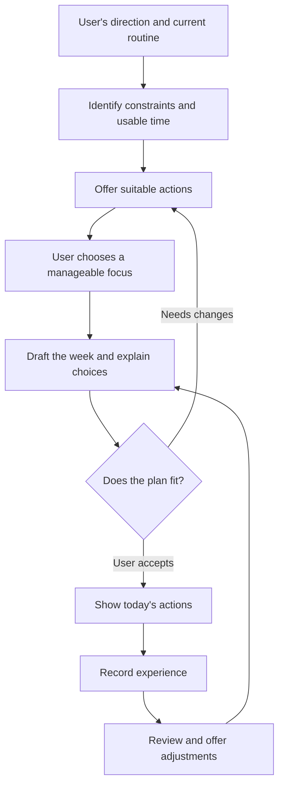

# Takeover — Product and 40-Day Program Roadmap

**Prepared for the Takeover project · October 16, 2026**  
**Status: consolidated proposal, ready to guide future implementation**  
**Source coverage: 51 supplied images, numbered 1–39 and 41–52. Slide 40 was not supplied.**

## How to use this document

Start with the executive direction, then use the onboarding, planning rules and delivery sequence to scope the next implementation. The appendix preserves the analysis of every supplied slide, including qualifications and obscured text.

This document combines three distinct inputs:

1. **Your requirements:** a personalized, balanced 40-day program spanning fitness, health, food, hygiene, relationships, time management, discipline, habits and personally meaningful interests; plans grounded in actual routines, strengths, preferences and resources; practical action in the present.
2. **The supplied coaching material:** ideas about direction, priorities, routines, support, focused work, learning and resources. Source descriptions are attributed to the slides, not treated as instructions to operate accounts or change the app.
3. **Product proposals:** the specific onboarding, planning logic, program phases, screens, data structures and implementation order below. These are design decisions to evaluate; they are not established scientific protocols or claims that features already exist.

The current app has not been audited for feature completeness as part of this research. Before implementation, map these requirements to what already works. Existing styling and user changes are constraints for that implementation. A new visual identity, payment activation and external service configuration are outside this document's implementation scope.

### Contents

- [Executive direction](#executive-direction)
- [1. Product promise and brand](#1-product-promise-and-brand)
- [2. Whole-life scope](#2-whole-life-scope)
- [3. Onboarding that changes the plan](#3-onboarding-that-changes-the-plan)
- [4. Personalization and planning rules](#4-personalization-and-planning-rules)
- [5. The 40-day program](#5-the-40-day-program)
- [6. The daily experience](#6-the-daily-experience)
- [7. Adaptation and progress semantics](#7-adaptation-and-progress-semantics)
- [8. Worked examples](#8-worked-examples)
- [9. Screens and information architecture](#9-screens-and-information-architecture)
- [10. Coaching content and evidence](#10-coaching-content-and-evidence)
- [11. Privacy, accessibility and measurement](#11-privacy-accessibility-and-measurement)
- [12. Implementation contracts](#12-implementation-contracts)
- [13. Delivery roadmap](#13-delivery-roadmap)
- [14. Initial content library](#14-initial-content-library)
- [15. Decisions and next implementation brief](#15-decisions-and-next-implementation-brief)
- [Appendix A — Analysis of every slide](#appendix-a--analysis-of-every-slide)

## Executive direction

**Takeover should help someone turn a life they want into a manageable plan for today, then use their experience to improve that plan across 40 days.**

The central product capability is the connection between what the person tells the app and what the app asks them to do. If someone has limited time, dislikes gyms, studies late, shares a kitchen and values family time, those answers must visibly change their plan.

The recommended initial experience is:

1. Understand the person's desired change and current circumstances.
2. Choose one main focus and, when useful, a small supporting routine.
3. Preview a feasible week and the purpose of the full 40-day period.
4. Make today's next action obvious.
5. Record what actually happened with little effort.
6. Review fit, barriers and usefulness each week.
7. Offer understandable adjustments for the person to accept or edit.
8. Finish with a useful account of progress and a chosen maintenance plan.

**First implementation priority:** complete this experience for a small, well-supported set of goals. Broader content, social features and integrations can follow once the planning and review experience is dependable.

### What the slides contribute

| Source theme | Useful principle | Proposed Takeover expression |
|---|---|---|
| Strengths, interests and goals — 1–3 | Direction can begin with what matters or what someone wants to explore | Discovery route, editable goal and concrete first action |
| Accountability and resilience — 4–9 | Follow-through benefits from realistic commitments and learning after setbacks | Honest logging, optional reflection and a workable return |
| Time, priorities and boundaries — 10–13, 29 | Plans need a feasible place in the day | Capacity-aware scheduling and chosen attention boundaries |
| Care and support — 14–18, 25 | Daily care and supportive relationships belong in the plan | Selectable care routines, recovery and optional accountability |
| Environment and travel — 19–24 | Context changes what is practical | Resource-aware alternatives and temporary schedule adjustments |
| Social environment and values — 26–35, 48–50 | Users should choose how to spend attention and nurture relationships | Personal values, respectful boundaries and connection actions |
| School and work — 36–39 | Existing responsibilities affect available effort | Deadline-aware plans and explicit trade-offs |
| Focused periods — 41–43 | A bounded priority can organize effort | Optional focus blocks with a purpose, review and end |
| Money and help — 44–47 | Resources and support should be used intentionally | Affordable actions and optional financial/admin habits |
| Recaps — 51–52 | Check topic coverage | Coverage audit; avoid inventing lessons from headings |

### Ten product commitments

- Personalization changes actions, timing, frequency, resources and language.
- Every proposed action has a reason the user can understand.
- The total plan fits the time the user has agreed is available.
- Whole-life balance includes rest, care, enjoyment and relationships.
- Users can maintain an area that already works instead of turning it into a new goal.
- Progress records distinguish completed work, smaller versions, changes, rest and unknown activity.
- Missing an action preserves the history of everything already done.
- Changes are understandable, editable and reversible where possible.
- Forty days defines the program's structure; outcomes remain individual.
- Health, financial and relationship content has a clear boundary between useful planning and unsupported prescriptions.

## 1. Product promise and brand

### 1.1 Positioning

**Working positioning statement:**

> Takeover helps you build routines around what matters to you. Choose your focus, create a practical 40-day plan, and adjust it as you learn what works in your life.

The brand can be ambitious and direct while treating the user as a capable person with real obligations. Takeover should communicate ownership of choices, attention and next steps. It should make room for people whose desired improvement is basic daily care, a calmer schedule, deeper relationships or a creative interest as well as career progress.

The slides frequently assume a young online entrepreneur. That audience can have a pathway, but the user brief supports a wider product. Career ambition must not determine how the app values a person or which life domains receive attention.

### 1.2 Proposed message hierarchy

| Placement | Draft copy | Purpose |
|---|---|---|
| Short brand line | **Take charge of today.** | Agency and present action |
| Main heading | **Build a routine around the life you want.** | Connect daily practice to personal direction |
| Supporting copy | A personalized 40-day plan shaped around your goals, time and real life. Start with practical actions and adjust as you go. | Explain the actual offer |
| Primary call to action | **Build my plan** | Concrete next step |
| Returning-user call to action | **Open today** | Return directly to useful work |
| Planning explanation | Your priorities set the direction. Your schedule shapes the plan. | Explain personalization |
| Completion message | Keep what works. Choose what comes next. | Support independence after the program |

These are draft content recommendations for existing components. They do not require a layout, colour, typography or animation redesign.

### 1.3 Voice rules

Use short, concrete language. Name the action, acknowledge circumstances and offer a useful choice. Encourage effort without turning results into character judgments. Direct language should explain what can be done next.

| Situation | Suggested voice |
|---|---|
| Starting | “Choose one change that would make your days better.” |
| An action feels too large | “What size would fit today?” |
| A missed action | “This one wasn’t logged. Keep it, change it, or leave it for now.” |
| A schedule conflict | “These actions need 35 minutes. You have 20 available. Choose what to move or shorten.” |
| A successful week | “You completed three planned sessions. Which part helped you return?” |
| An optional increase | “Would you like to keep this pace or try a little more?” |
| Uncertainty | “You can start with an experiment and decide after trying it.” |
| Program completion | “Here is what you practised, what changed, and what you chose to keep.” |

Avoid publishing claims such as guaranteed transformation, subconscious rewiring, becoming superior to a percentage of people, or success through proximity to wealthy friends. Avoid copy that equates a missed day with laziness or broken integrity. Content about relationships should describe behaviours and choices without assigning broad verdicts about people.

### 1.4 Define discipline in product terms

For Takeover, discipline can be expressed as choosing a feasible commitment, making space for it, following through when possible and reviewing honestly when the plan needs to change. Make those behaviours available in the interface. A motivational slogan cannot replace an editable action, a realistic time window or a recovery path.

**Sources informing this section:** 1–9, 12–14, 25, 28, 31–35, 48–52. The positioning and copy are original proposals.

## 2. Whole-life scope

### 2.1 A broad profile with a manageable current focus

Let users acknowledge all areas of life they care about while choosing which ones need active work during this program. Each domain can be marked **focus**, **maintain**, **later** or **not relevant**. A person should be able to select “this already works for me.”

Begin with a suggested main focus and an optional supporting routine. Additional goals require a visible check of the combined load. This is a starting design choice, not a scientifically established ideal number of goals.

| Domain | What planning needs to know | Example controllable action | Important boundary |
|---|---|---|---|
| Movement and fitness | Experience, preferences, access, available time and relevant limitations | Complete a familiar, appropriate movement session at a chosen time | A specific training prescription needs reviewed content and suitable context |
| Sleep and recovery | Current schedule, shifts, care duties and desired wind-down | Prepare the chosen wind-down environment | Going to bed is an action; actually sleeping is an outcome |
| Food and meals | Preferences, dietary requirements, budget, kitchen access and confidence | Plan ingredients for a familiar meal | Avoid arbitrary restrictions, body judgment and automatic diet prescriptions |
| Hygiene and personal care | Existing routine, supplies, access needs and preferred reminders | Prepare supplies and follow the user's established care routine | Hygiene is explicitly requested by the user; detailed instructions are not supplied by these slides |
| Focus, time and attention | Deadlines, usable windows, interruption patterns and work requirements | Work on a named task for a chosen block | A timer does not imply the app can block other applications |
| Emotional well-being and recovery | Preferred forms of rest/reflection and support, if the user wishes to share | Take a chosen pause or write a brief reflection | Check-ins are not diagnostic tools |
| Relationships and community | Desired connection, boundaries and private/shared preference | Offer a catch-up or spend planned time together | Another person's response is not the user's completion criterion |
| Learning, interests and creativity | Curiosity, current skills, materials and enjoyment | Try one small activity or apply one lesson | Users may explore without declaring a lifelong purpose |
| School and work | Required commitments, preparation, commute and upcoming demand | Prepare a defined section of coursework | The app should not infer that someone should leave education or employment |
| Money and life administration | Chosen organizational goal and relevant resource limits | Review a set of expenses or organize one document | No universal investment allocation or implied financial-account access |
| Home and environment | Shared space, equipment, household responsibilities | Prepare a usable work surface | Respect shared arrangements and accessibility |

### 2.2 Balance is a planning rule

Balance means a proposed program respects the person's protected responsibilities and care. It does not require equal time in every domain or a daily task from every category.

For example, a student may focus on consistent study, maintain existing movement and hygiene routines, and keep a weekly family call. An employee may focus on meal preparation while keeping current hobbies and training unchanged. A beginner may focus on getting a workable evening routine in place before adding another goal.

If the user already walks to work, cooks regularly or follows a personal care routine, the app can recognise this existing activity with permission. It should not create duplicate obligations just to populate categories.

### 2.3 Special pathways

Travel, business administration, networking and delegation can be optional context-specific pathways. They should reuse the same goal, action, schedule and review system. Building separate mini-apps for every slide would create unnecessary complexity.

**Sources:** 10–25, 36–47, 50–52; hygiene and broad life coverage also come directly from the user brief.

## 3. Onboarding that changes the plan

### 3.1 Design approach

Collect enough information to make a useful initial proposal, then ask additional questions only when they affect a chosen action. Save progress, allow backtracking and show which information can be skipped. Users can edit their answers later.

The proposed flow has eight stages. Several can be combined into one short screen using existing components. Avoid turning every field below into a separate mandatory question.

| Stage | Example prompt | Information captured | Visible effect on the plan |
|---|---|---|---|
| 1. Desired direction | “What would you like to be easier or more consistent in your life?” | Selected domain and reason, or unsure route | Sets the first focus or discovery experiment |
| 2. Starting point | “What does this look like in a normal week?” | Current routine, frequency and what already works | Starting actions relate to actual experience |
| 3. Interests and strengths | “What do you enjoy? What do you already feel comfortable doing?” | Preferences, existing skills, disliked methods | Selects relevant action options and exploration routes |
| 4. Capacity | “When could this realistically fit?” | Usable windows, day-specific time, fixed obligations | Controls timing and total load |
| 5. Resources and constraints | “What do you have available? What should the plan work around?” | Equipment, space, budget, access and goal-specific constraints | Removes unsuitable or unaffordable options |
| 6. Support and guidance | “How would you like Takeover to support you?” | Private/shared preference, reminder choice, tone | Changes reminders, copy and optional support features |
| 7. Select actions | “Which of these would you like to try?” | User choice of action, frequency and smaller alternative where appropriate | Creates a specific draft routine |
| 8. Review and begin | “Does this fit your week?” | Accepted plan, start date, unresolved conflicts | Starts only the plan the user accepts |

### 3.2 The unsure route

If the user has neither a clear goal nor a known strength, show a small set of possible starting points: something they are curious about, something that makes daily life difficult, or something they would like to make time for. Let them type their own answer.

Propose one small experiment with a review point. The review asks whether it was interesting, useful, feasible and worth repeating. Keep “try something else” available. Do not infer a permanent personality type from one preference or one successful session.

**Illustration:** a user curious about drawing chooses a short sketch session using materials they already have. Their goal for the first week is to discover whether they enjoy returning to it. No business, performance or monetization goal is added.

### 3.3 Make the baseline understandable

Prefer descriptions the person can answer without searching records:

- “I already do this most weeks.”
- “I do it occasionally.”
- “I’m starting or returning.”
- “My schedule changes a lot.”
- “I’m not sure yet.”

Add numeric detail only where useful. “Two sessions last week” can help schedule a practice goal. A complex composite life score is unnecessary for generating a first plan.

### 3.4 Capture capacity honestly

Support both a regular weekly schedule and a variable schedule. Let users supply available windows without disclosing every appointment. Ask about near-term exams, travel, shifts or other known changes when relevant.

Time for a habit may include preparation, travel, cleanup and recovery. A 20-minute activity requiring 15 minutes of travel each way is not a 20-minute commitment. Ask whether the estimate includes those parts rather than silently assuming.

“No extra time this week” must be a valid answer. The app can offer a later start, a review of the existing routine, a swap the user agrees to, or maintaining current care. It should not force additional tasks into protected sleep or responsibilities.

### 3.5 Conditional detail

| Selected goal | Ask only if needed | Do not require by default |
|---|---|---|
| Meal planning | Dietary requirements, kitchen/storage access and preferred foods | Weight, body images or calorie targets |
| Movement | Activity preferences, equipment and relevant restrictions the user wants considered | Body transformation target or paid gym |
| Wind-down | Sleep schedule and shift/care constraints | Wearable connection |
| Connection | Desired action and privacy preference | Contact list, message history or another person's personal details |
| Money organization | What they want to organize and any chosen spending limit | Exact salary, bank credentials or transaction upload |
| Personal care | Existing practice, access needs and helpful cues | Photos, appearance judgments or sensitive medical detail |

Any future health guidance must know which population it is intended for. For the initial product proposal, adult-oriented reviewed content is a planning assumption. Supporting minors requires a deliberately scoped age-appropriate experience before launch; the app should not apply adult numerical guidance to unknown-age users.

### 3.6 The plan preview

Before starting, show:

- The chosen focus and the user's reason.
- What they already do that the plan recognises.
- The first week's actions, frequencies and windows.
- Estimated effort, including preparation where relevant.
- A short explanation for each recommendation.
- Protected time and unresolved conflicts.
- Any easier alternative the user has selected.
- The first review date and expected program end date.
- Edit, remove, change start date and accept controls.

An example explanation is: “You chose home-based options and evenings, so this action fits the Tuesday and Thursday windows you provided.” If a relevant answer is missing, label the assumption and invite correction. Never claim personalization from data the user did not give.

**Sources:** 1–4, 10–18, 21, 24–25, 35–39, 42, 44–50. The flow and field design are original proposals.

## 4. Personalization and planning rules

### 4.1 Planning order



### 4.2 Hard constraints and preferences

**Hard constraints** are boundaries a draft must respect: a fixed class or shift, an unavailable resource, an allergy relevant to a food suggestion, a declared restriction, an agreed spending ceiling, protected rest or a sharing permission.

**Preferences** guide selection within those boundaries: mornings versus evenings, indoors versus outdoors, individual versus shared activities, reminder style, familiar versus exploratory options.

If constraints leave no feasible action, show that clearly and offer a smaller suitable scope, different date, alternative or pause. Do not silently ignore a constraint to finish generating a plan.

### 4.3 Minimum action specification

Each planned action needs enough detail to be executable:

| Field | Purpose |
|---|---|
| Goal link | Shows why the action is here |
| Plain-language instruction | Names the actual task |
| Frequency and occurrence | Distinguishes once, selected days, weekly target or routine |
| Window or anchor | Gives it a place in the user's day |
| Duration estimate | Supports capacity planning |
| Preparation/resources | Reveals hidden effort and dependencies |
| Completion condition | Makes logging understandable |
| Optional alternative | Gives a suitable smaller or different version where appropriate |
| Context limits | Prevents unsuitable recommendations |
| Source/content version | Supports review and correction |

**Example:** “After dinner on Tuesday and Thursday, spend 15 minutes reviewing the next course section at your desk. Have the notes ready. Completion means doing the chosen review, with optional notes about what to revisit. If Tuesday is crowded, choose the five-minute recap version or reschedule.”

This is an illustrative study action. A smaller version must be meaningful for that activity. Do not automatically shorten prescribed care, medication routines or other instructions that depend on professional guidance.

### 4.4 Capacity rules

1. Use the person's confirmed usable windows. Exclude overlaps with protected commitments.
2. Include preparation and transition effort once; avoid double-counting time already included in the estimate.
3. Leave the buffer the user has chosen. Ask if an estimate is uncertain.
4. Compare proposed effort with both daily and weekly capacity.
5. Keep tasks within a compatible time window or leave them explicitly unscheduled for user choice.
6. When adding a goal, show its effect on the existing plan.
7. Offer a concrete trade-off if the draft does not fit.

As a simple planning condition, **the sum of additional action estimates for a day must fit within the usable time the user has confirmed for those actions**. This is a feasibility check, not a prediction of energy or performance. Users can revise their estimates as they learn.

### 4.5 Prioritization

Use the user's priorities first, then real deadlines, dependencies, resource availability and suitable windows. A task due tomorrow may need attention before a long-range goal. An action that requires groceries should not be scheduled before the ingredients are available.

When two goals compete, explain the conflict. Example: “You chose a study block and a cooking session for the same evening. Which would you like to move?” If the user has already established a priority rule, apply it and show the result in the draft.

Avoid opaque ranking of life domains. A relationship action can be the most important action of a day even if it does not generate income or a measurable output.

### 4.6 Existing routines and duplication

One occurrence can support several goals. A planned walk with a friend may support movement and connection, if the user chooses those labels. Count the time once and show one completion record. Avoid stacking separate movement, stress-management and social tasks that all describe the same activity.

An existing routine can be recognised without demanding another check-in. Ask whether the user wants it displayed, tracked or simply protected in planning.

### 4.7 Appropriate use of AI

If AI is used, its useful roles are translating a goal into clear wording, proposing options from approved content, explaining a draft and summarizing user-entered experience. Scheduling constraints, permissions, counts and history should have explicit application rules.

All generated suggestions must pass the same suitability and capacity checks as templates. Sensitive health guidance should come from reviewed material. Generated text must not invent diagnoses, user history, professional recommendations, institutional policies or investment outcomes.

The planner should remain usable through templates and manual editing when generation is unavailable. Show a retry or simple manual option without discarding the user's answers.

### 4.8 Explain changes

Every adjustment should answer three questions: what changed, why it was suggested and what will happen if accepted. Keep the old plan version for history. A proposed change is not active until the user accepts it, except immediate UI-only preferences such as collapsing a card.

**Sources:** 3–6, 10–13, 15–18, 20–25, 35–39, 41–47. The rules and architecture are original proposals.

## 5. The 40-day program

### 5.1 Purpose and timing

Forty days is the chosen product structure for practice, observation and adjustment. Completing the period should produce a record of what the user tried, what felt useful, what changed and what they want to continue. It does not establish that every habit is automatic or every goal achieved.

**Recommended day semantics:** a program begins on the user-selected local date. Days advance by local date while the program is active, including days when nothing is logged. An explicit pause freezes the program day and moves the expected finish date by the paused period. Missing an action never restarts the program. The interface shows both the program day and calendar date.

Before pausing, show the effect on the finish date. On return, invite a review of upcoming commitments. If the user changes time zones, preserve completed occurrences and offer clear handling of remaining windows. A timezone change must not create duplicate credit or erase a day of history.

### 5.2 Six phases

| Days | Purpose | Expected experience | Review decision |
|---|---|---|---|
| **1–7: Establish a starting routine** | Learn whether the first plan fits | Try selected actions, observe effort and timing | Keep, simplify, move or replace |
| **8–14: Improve consistency** | Make useful actions easier to return to | Refine cues, preparation and frequency | Choose a sustainable pace |
| **15–21: Shape the environment** | Address actual friction | Adjust space, attention boundaries or support if relevant | Retain changes that help |
| **22–28: Practise adaptation** | Handle busy or changed days | Use a chosen alternative, reschedule or pause when needed | Define what to do when life changes |
| **29–35: Build independence** | Let the user lead planning | Choose the next week's priorities and guidance level | Keep the amount of support they want |
| **36–40: Review and continue** | Consolidate learning | Summarize actions, outcomes and preferred routines | Maintain, change focus, start another cycle or take a break |

The phase schedule is an original product proposal. The slides do not supply a tested 40-day intervention. Increasing workload is never a required phase transition.

### 5.3 A complete 40-day coaching outline

These are **optional prompts attached to existing actions or reviews**, not 40 extra assignments. A user may dismiss them. Review time counts toward the plan's effort budget and can replace another optional activity. If a topic is irrelevant, use a relevant prompt or show none.

| Day | Coaching focus | Optional prompt or planning action |
|---|---|---|
| 1 | Begin with purpose | Name the change that matters and take the first accepted action. |
| 2 | Notice the starting point | Was the action the right size for a normal day? |
| 3 | Connect to a cue | Choose a useful time, place or existing routine as an anchor. |
| 4 | Remove one obstacle | Prepare one thing that made starting difficult. |
| 5 | Choose an alternative | Define a suitable smaller version or a rescheduling option. |
| 6 | Recognise existing strengths | Notice a routine or resource that already helped. |
| 7 | First review | Keep, change, replace or pause based on the first week. |
| 8 | Repeat deliberately | Follow the revised plan and check whether the change helps. |
| 9 | Clarify priority | Choose the most important planned action for today. |
| 10 | Protect time | Identify a time window worth keeping clear. |
| 11 | Check real effort | Compare the estimate with the time actually needed. |
| 12 | Support daily care | Check whether the plan leaves room for care and recovery. |
| 13 | Make room for enjoyment | Recognise an enjoyable activity as a legitimate choice. |
| 14 | Second review | Decide whether the current frequency is sustainable. |
| 15 | Improve the environment | Make one chosen preparation or space adjustment. |
| 16 | Use attention intentionally | Set a purpose or stopping point for a distracting activity, if relevant. |
| 17 | Consider support | Choose whether a check-in or practical request would help. |
| 18 | Communicate a boundary | Draft a clear availability message if the user wants one. |
| 19 | Apply learning | Use one useful idea in a small action. |
| 20 | Nurture connection | Make room for a chosen person or shared activity. |
| 21 | Third review | Identify which environmental or support changes helped. |
| 22 | Anticipate change | Look at an upcoming busy day or altered schedule. |
| 23 | Choose a response | Select a suitable alternative or leave the plan as it is. |
| 24 | Protect recovery | Adjust optional load if the user reports needing more room. |
| 25 | Return after interruption | Choose a next step without trying to repay missed tasks. |
| 26 | Check resources | Review whether the plan still fits available time, space and money. |
| 27 | Revisit direction | Ask whether the goal still matters in its current form. |
| 28 | Fourth review | Record a practical plan for predictable disruptions. |
| 29 | Lead the week | Let the user choose the next week's emphasis. |
| 30 | Choose guidance level | Keep, reduce or change reminders and prompts. |
| 31 | Use personal evidence | Name what has actually helped so far. |
| 32 | Choose the pace | Maintain the current routine or consider a suitable change. |
| 33 | Honour values | Check what the goal supports and what needs protecting. |
| 34 | Reduce friction | Simplify a recurring difficulty without adding a new obligation. |
| 35 | Fifth review | Select routines worth carrying beyond the program. |
| 36 | Look back | Compare the starting point with current experience. |
| 37 | Plan maintenance | Choose a feasible frequency for continuing practices. |
| 38 | Plan for difficult weeks | Record a fallback, pause or return preference. |
| 39 | Choose what follows | Maintain, change direction, begin another cycle or take a break. |
| 40 | Complete and reflect | Export or save a summary and confirm the chosen next step. |

### 5.4 The review itself

Use a short review that can be completed with selections and optional notes:

1. What happened? Show actual records, including gaps and adaptations.
2. How did it fit? Ask about effort, timing and usefulness.
3. What got in the way? Allow a reason or skip.
4. What should stay? Identify helpful actions and circumstances.
5. What should change? Present a small number of concrete choices.
6. Does the next week fit? Confirm the draft and new context.

Keep the milestone review available later if the user misses the scheduled date. Do not accumulate multiple overdue review forms. A later review can cover the elapsed period and explain the date range.

### 5.5 Focus mode within the program

An optional focus period can be used for a specific project. It has a chosen objective, compatible blocks, protected obligations, an end date and a review. It can begin at any relevant point; it is not an achievement level users must unlock.

Its scope might be “work on the first draft during three available evening blocks.” The intense all-day work quotas in the source are not suitable universal defaults. Ending or changing focus mode should preserve the program and completed work.

### 5.6 Completion at day 40

The closing summary should include the original reason, actions attempted, action history, user-reported changes, helpful circumstances, unresolved barriers and selected next steps. It should distinguish completing the program period from meeting a specific outcome target.

Offer a useful downloadable summary. Continuing should be an explicit choice, with maintenance as a valid option. Do not silently enrol someone in another challenge or require a larger goal to celebrate the work already done.

**Sources:** 3–6, 10–13, 18, 20–25, 32, 35–39, 41–43. The exact sequence, day semantics and maintenance design are original proposals.

## 6. The daily experience

### 6.1 Today should answer four questions

1. What matters today?
2. What have I planned, and where does it fit?
3. What is the next useful action?
4. What can I do if today has changed?

Show the program day/date, the selected priority, today's scheduled actions and their estimated total effort. Keep unrelated learning content and long-term aspirations secondary. An optional capacity selection can appear when useful, but users should be able to open an action without completing a survey.

### 6.2 Proposed content order

```text
TODAY · DAY 9 OF 40
Your focus: make study sessions easier to start

Today’s plan · about 25 minutes

Review the first section · 15 min
After dinner · Notes at your desk
[Open action] [Change]

Prepare tomorrow’s materials · 5 min
Before winding down
[Done] [Change]

Optional reflection · about 5 min
What helped you begin?
[Reflect] [Skip]

Need a different plan today? [Adjust today]
```

This is an information example, not a visual redesign. The five-minute reflection is included in the displayed estimate. If the user chooses to skip it, show the remaining planned effort accurately.

### 6.3 Action detail

An action opens with its instruction, purpose, chosen window, needed resources and completion condition. A timer may be available for time-based work, but manual completion remains possible. A timer ending is not proof the action happened.

Useful controls are **Done**, **Use my alternative**, **Reschedule**, **Skip this time** and **Edit future occurrences**. Avoid forcing an explanation for every adjustment. Optional notes can be private.

Distinguish editing today's occurrence from changing the whole recurring routine. A person who moves Tuesday's session should not accidentally move every future Tuesday.

### 6.4 Logging without friction

Use a quick explicit completion action. Let the user optionally record time, an amount or a note when useful for their goal. Avoid mandatory photos, screenshots or proof uploads.

If the user did something different, allow them to record it accurately and decide whether it supported the same goal. Keep the difference visible in the history. Do not automatically equate every substitute with the original action.

If an action is already complete, prevent accidental duplicate records. Allow correction and undo. If a save fails, retain the user's input and say it is unsaved; do not display a durable success state before the save succeeds.

### 6.5 Adjust today

Show the current plan and concrete options:

- Keep the plan.
- Use an already chosen suitable alternative.
- Move an action to another feasible window.
- Remove an optional action from today.
- Mark planned recovery or take a program pause.

Explain the consequences before applying a change. The user may also edit directly. The adjustment should not create a pile of obligations tomorrow.

### 6.6 Close the day

Offer a short optional reflection: what helped, what was difficult or what should change. A simple selection such as “manageable,” “too much” or “timing did not work” can be enough. Free text is optional.

Give the interface a stopping point: “Your updates are saved.” If tomorrow is ready, a small preview can be available. There is no need to keep the user in an advice feed after they have planned or logged their actions.

### 6.7 Reminders

Ask for reminder preferences after showing their purpose. Support chosen times, quiet hours and off. Group notices where possible. A changed schedule should update pending notices; completing or skipping an occurrence should cancel its unnecessary reminder.

Notification copy should be discreet by default: “Your planned action is ready when you are.” Let users choose whether details can appear on a lock screen. Avoid escalating messages, public failure alerts or reminders that pressure someone to sacrifice rest.

**Sources:** 3–6, 10–13, 18, 25, 27–29, 32, 42. Screen content and behaviour are original proposals.

## 7. Adaptation and progress semantics

### 7.1 States must mean something specific

| State | Meaning | How it appears in progress |
|---|---|---|
| Planned | An occurrence is scheduled and not yet resolved | Upcoming or current plan |
| Completed as planned | The user records meeting the accepted completion condition | Completed count |
| Completed alternative | The user records a chosen alternative | Adapted count with the version shown |
| Partial | Some work happened without meeting the completion condition | Partial activity shown honestly |
| Skipped | The user explicitly chose not to do the occurrence | Skipped count; optional reason |
| Unlogged | The window/date passed without a record | Unknown activity, not an inferred failure |
| Rescheduled | The same occurrence moved to a new window | New schedule plus move history; one occurrence |
| Cancelled by plan change | A future occurrence was removed from the plan | Change history, not a retroactive completion |
| Planned recovery | Rest or recovery was deliberately scheduled | Visible plan context, not an exercise completion |
| Program paused | The user explicitly paused the program | Paused interval and changed expected finish |

For a weekly flexible target, such as two sessions in a week, create distinct occurrences when they are scheduled or logged. Show “one of two planned sessions recorded” without inventing a missed Monday appointment that was never selected.

### 7.2 Suggested adaptation rules

| What the app knows | Appropriate offer | Required restraint |
|---|---|---|
| One occurrence is unlogged | Ask whether the user wants to record it or leave it unknown | Do not infer laziness or silently mark it complete |
| The user repeatedly says timing is difficult | Offer another window or frequency | Ask before changing the accepted routine |
| An action takes longer than estimated | Revise the next draft estimate and show the capacity effect | Do not compress other protected time |
| The user reports low capacity today | Offer less optional load, an appropriate alternative or rest | Do not diagnose or lower every goal automatically |
| The plan feels easy and useful | Offer maintaining the pace or one suitable increase | Completion counts alone do not justify physical intensity changes |
| The user dislikes an activity | Offer a different method serving the same chosen goal | Do not insist that dislike proves weak discipline |
| A deadline or exam period is approaching | Offer a dated reduction or pause in optional work | Keep the user's real obligations visible |
| Travel or a shift changes context | Offer new windows and resource-compatible actions | Preserve time-zone and occurrence identity |
| Several goals exceed capacity | Show the conflict and ask which scope to reduce | Do not silently demote meaningful relationships or care |
| No suitable action fits | Offer a later start, maintenance or a change of scope | A zero-addition day is a valid result |

These are product rules, not claims that a particular threshold predicts behaviour. Begin with user-reported fit and scheduled reviews. If later introducing automated triggers, make their criteria visible and evaluate whether users find the resulting suggestions helpful.

### 7.3 Accurate history

Changing a target today should affect future planning and keep the old target in historical records. If a user corrects an earlier log, record the actual activity date and update the summary transparently. Editing should not rewrite what the accepted plan was at that time.

Show simple counts before presenting ratios. For example: **three completed as planned, one completed alternative, one skipped and one unlogged**. If a percentage is used, define the numerator, denominator and date range. Do not hide adaptations inside a perfect-completion score or treat a rest day as a missed workout.

### 7.4 Streaks and rewards

The recommended core view emphasizes cumulative practice and personal milestones. Streaks, if retained from the current app, should have an explicit definition and respect the action's schedule. An action planned twice weekly should not require daily logging to preserve its streak.

Rewards can acknowledge starting, returning, completing a chosen milestone or finishing a review. Avoid awarding higher status for extreme workloads, spending money, sleep deprivation or personal disclosure. A badge describes an activity, not a person's worth.

### 7.5 Pause and return

A pause screen shows the current program day, what happens to upcoming occurrences and how the expected finish date changes. Suspend program reminders. Preserve historical activity. On resume, ask whether the previous routine still fits and present a revised upcoming week if needed.

An ordinary missed day differs from a pause. The user should not have to retrospectively pause every difficult day to protect their record. Keep any manual date correction distinct from rewriting program status.

**Sources:** 4–6, 11–12, 20–25, 32, 36–39, 41–43. State definitions and adaptation rules are original proposals.

## 8. Worked examples

All people and numbers in this section are illustrative. They demonstrate planning behaviour, not a prescription for the reader or a scientifically validated dose.

### 8.1 Student with a busy week

**Profile:** classes and work shifts already occupy much of the week. The person wants to begin coursework more consistently, already has a satisfactory personal care routine, and wants to keep a weekly conversation with family. They have confirmed usable windows and prefer short evening sessions.

**Selected focus:** make study sessions easier to begin.  
**Supporting action:** prepare the next session's materials.  
**Maintained commitments:** existing care, chosen rest and family time. These are accounted for before the available windows below.

| Day | Confirmed time for additional program activity | Draft | Planned effort |
|---|---:|---|---:|
| Monday | 25 minutes | Review one course section; prepare next materials | 20 minutes |
| Tuesday | 15 minutes | Short recap using existing notes | 10 minutes |
| Wednesday | 0 minutes | No additional program task | 0 minutes |
| Thursday | 30 minutes | Work on one named assignment section | 20 minutes |
| Friday | 15 minutes | Prepare the next study starting point | 5 minutes |
| Saturday | 40 minutes | User-chosen coursework block | 30 minutes |
| Sunday | 15 minutes | Review the week and choose the next plan | 10 minutes |
| **Total** | **140 minutes** | **Accepted draft after editing** | **95 minutes** |

The remaining 45 minutes are not automatically filled. Estimates include the stated preparation. The plan supplements the student's required study commitments only if they confirm those commitments are already included in their overall schedule; otherwise the app must clarify before accepting the draft.

**A disrupted Thursday:** the user chooses to move the 20-minute block to Saturday. Saturday would then contain 50 minutes against 40 available, so the app offers a replacement of Saturday's original block, a shorter suitable task or another date. It cannot simply add the block and call the week feasible.

**An exam period:** the user can narrow the optional program focus to exam preparation or pause optional goals. The app does not advise leaving school or infer ability from how easily the user completes coursework.

### 8.2 Shift worker improving food routines

**Profile:** weekly shifts vary; the user has a shared kitchen, prefers familiar food and wants to reduce last-minute meal decisions. They want a modest preparation routine and have not selected weight change as a goal.

**Initial proposal:** one weekly planning action, one preparation opportunity when kitchen access is available, and an optional short reminder to check needed ingredients. The plan uses their declared dietary requirements and chosen budget.

**How personalization appears:** the action is anchored to “after waking on a non-work day” rather than a fixed morning time. A kitchen-access conflict produces a user-chosen alternative that fits the resources available. The app records actual preparation effort to improve the next week's estimate.

**What is measured:** whether the planning/preparation action happened and whether it helped the user. The app does not infer nutrition quality from a checkbox or promise a particular health or weight outcome.

### 8.3 Returning beginner with limited capacity

**Profile:** the user wants more movement and steadier evenings, has limited discretionary time, prefers activities at home and wants private progress. They have described a familiar suitable activity and a personal care routine they want to protect.

**Initial proposal:** a small number of user-chosen movement opportunities and one preparation cue supporting the evening routine. Detailed movement instructions must come from suitable reviewed content or the user's existing guidance. There is no forced training frequency from the slides.

**A difficult day:** the user chooses recovery and removes an optional action. The app records the choice without pretending the movement session occurred. On the next relevant day, it presents the accepted plan without a debt of missed sessions.

**A useful week:** the user can keep the same plan. The app does not automatically increase intensity or number of habits.

### 8.4 Exploring an interest without a clear goal

**Profile:** the user wants something meaningful outside work but is unsure what. They enjoy music, prefer inexpensive options and have one open weekend window.

**Initial proposal:** choose a small exploration using something already accessible. After trying it, reflect on enjoyment, difficulty and desire to repeat. They can continue, choose another exploration or stop.

**Success of the product interaction:** the user tried a chosen activity and learned something relevant to their preferences. Takeover does not manufacture a career plan or interpret a single session as a lifelong passion.

## 9. Screens and information architecture

### 9.1 Proposed destinations

Map these responsibilities into existing routes and navigation before adding new destinations. Some may be sections or dialogs within an existing screen.

| Destination | Primary job | Essential content |
|---|---|---|
| Start / Onboarding | Understand the person and build a draft | Direction, context, selected actions, plan preview |
| Today | Help the user act | Priority, occurrences, effort, next action and adjustments |
| Plan | Make the week understandable and editable | Windows, frequencies, protected context, conflicts, pause |
| Goals | Explain direction and scope | Reason, baseline, chosen milestone, linked actions |
| Review / Progress | Learn from experience | Honest history, personal trends, weekly decisions, day-40 summary |
| Profile / Preferences | Keep personalization current | Resources, availability, reminders, privacy and guidance preferences |
| Support | Optional connection and sharing | Chosen partner, scope, consent and revoke controls; later scope |
| Learn | Optional relevant guidance | Short reviewed items with clear applicability; later scope |

### 9.2 Key states to design

- No goal selected: offer a simple focus choice or exploration route.
- No capacity available: offer maintenance, later start or an explicit trade-off.
- Draft has conflicts: name the conflict and present editable options.
- Today has no scheduled actions: explain that the schedule allows this; do not populate arbitrary work.
- All planned actions resolved: show a clear saved/completed state.
- Some actions unlogged: preserve uncertainty and allow later recording.
- Program paused: show the pause status and an accessible resume action.
- User returning after a gap: summarise current state and offer a manageable next step.
- Generation or storage unavailable: preserve inputs, explain the limitation and offer manual/retry paths.
- Program period complete: show the summary and voluntary next choices.

### 9.3 Fit within the current design

Reuse existing typography, spacing, surfaces, colours, navigation patterns and controls wherever possible. The roadmap specifies content and interaction responsibilities. Before changing a component, identify what already supports the requirement and preserve user-authored styling.

Avoid introducing numerous new dashboards to display the same underlying data. A goal, its action and its progress should share a consistent name throughout the app. If the current interface has strong motivational visuals, retain them while making the next action and schedule readable.

### 9.4 Interaction accessibility

Use descriptive control labels, keyboard-operable actions, visible focus, readable text, adequate contrast and status conveyed through text as well as colour. Support reduced motion. Avoid making timed interactions the only way to log work. Users should be able to complete important flows without dragging items on a calendar.

Error messages should identify what needs attention and retain user input. Long explanations can be expandable, with essential instructions visible. Access needs should inform options without forcing a diagnosis into the profile.

**Sources informing the flow:** 3, 10–13, 18, 25, 28–29, 32. The navigation and accessibility requirements are original product proposals.

## 10. Coaching content and evidence

### 10.1 Editorial approach

Use the slides to identify useful themes, then write original content appropriate to Takeover's broader audience. Store the source slide references for internal traceability. A source example is not automatically a default routine, scientific fact or instruction for every user.

The appendix keeps the source's message, the extracted principle, the proposed feature and the qualification distinct. Unknown titles, obscured sentences and undeveloped headings stay unknown. The coach's identity has not been established.

### 10.2 Claims that need qualification

| Slide(s) | Source claim or framing | Product treatment |
|---|---|---|
| 4, 7–9 | Missed actions reveal unreliable identity; subconscious percentages; theta-driven identity change; manifestation | Use action planning, optional reflection and credible self-talk. The supplied material does not establish those mechanisms. NCCIH describes uncertainty in interpreting meditation-related brain findings. [NCCIH](https://www.nccih.nih.gov/health/meditation-and-mindfulness-effectiveness-and-safety) |
| 12, 33–35 | Competitive percentages, criticism as envy, disadvantage framed as enjoyable | Remove unsupported rankings and motive judgments. Use personal context, respectful feedback and practical learning. |
| 15 | Broad seed-oil and processed-food warnings | Avoid blanket bans. Health Canada includes canola and soybean oils among healthy-fat choices and distinguishes useful processing such as canning and freezing. [Healthy fats](https://www.canada.ca/en/health-canada/services/food-guide/explore/healthy-eating-recommendations/eat-variety/choosing-healthy-fats.html), [Processed foods](https://www.canada.ca/en/health-canada/services/food-guide/explore/healthy-eating-recommendations/limit-highly-processed.html) |
| 15 | Commercial gut-test imagery and diet-to-income claims | No product recommendation or causal income claim follows from the screenshot. |
| 16 | Universal eight hours plus an extra hour; red lights or glasses as solutions | Support a suitable routine and wind-down. NHLBI supports regular scheduling and reducing bright artificial light before bed; that does not validate every product or exact rule in the slide. [NHLBI](https://www.nhlbi.nih.gov/health/sleep-deprivation/healthy-sleep-habits) |
| 17, 25, 42 | A fixed daily movement and training schedule for everyone | Use appropriately reviewed guidance and individual starting context. CDC's general adult guidance is expressed in weekly aerobic activity and strength work, rather than the source's universal daily schedule. [CDC](https://www.cdc.gov/physical-activity-basics/guidelines/adults.html) |
| 24 | A particular overseas lifestyle at a quoted cost | Treat it as an unverified source example; current travel costs and local conditions were not researched. |
| 27–30 | Ban platforms, unfollow everyone, cut off friends/family | Support purpose, availability and user-chosen boundaries. Avoid automatic account changes or relationship verdicts. |
| 38–39 | Drop out when confident; school difficulty predicts future business growth | Offer decision reflection and workload planning. No dropout recommendation or outcome prediction is established. |
| 41–43 | Every waking minute devoted to one goal; long daily work quotas | Use bounded optional focus periods compatible with the user's life. |
| 44–47 | Tenfold returns, 10/90 budgets, revenue-based hiring triggers | Treat ratios and thresholds as source examples. FCAC bases budgeting on actual income, expenses and circumstances; Investor.gov explains that investments involve risk and possible loss. [FCAC](https://www.canada.ca/en/financial-consumer-agency/services/make-budget.html), [Investor.gov](https://www.investor.gov/introduction-investing/investing-basics/save-and-invest/understand-what-it-means-invest) |
| 48–50 | Wealth follows proximity to millionaires; friends determine the future; friend counts prove motives | Use voluntary reflection on support, respect, connection and shared interests. These slogans do not establish predictions about a user's life. |

These checks are targeted corrections, not a systematic review of all coaching claims or evidence that the proposed app will produce particular outcomes. Sources were consulted on October 16, 2026. Numerical health guidance must be checked for the intended audience when content is prepared for release.

### 10.3 Content structure

Each reusable coaching item should contain a title, plain-language purpose, when it is relevant, what the user can choose to do, estimated effort if any, applicability limits and source/review metadata. Keep it short enough to read at the point of action.

Health instruction requires an appropriate review process before publication. The same applies to detailed financial or jurisdiction-specific guidance. A generic life-planning app should not improvise treatment, tax advice or a professional exercise program from a short intake.

### 10.4 Resolve tensions across the source material

| Tension | Recommended product resolution |
|---|---|
| Balance versus total immersion | Care and obligations remain planning constraints; focused work is optional and bounded. |
| Avoid social media versus use it to connect | Ask the purpose, choose a boundary and support intentional contact. |
| Distance from people versus build support | Help users make contextual choices and communicate; avoid blanket relationship rules. |
| Travel for growth versus stay home to work | Treat travel as optional context with trade-offs; offer local ways to learn and connect. |
| Work continuously versus recover from stress | Include recovery and manageable load in the schedule. |
| Spend only for return versus enjoy life | Let users decide what supports care, enjoyment and other priorities within their means. |
| Commit firmly versus adapt | Keep commitments explicit while allowing honest, documented changes. |

These resolutions come from the user's balanced whole-life brief and product judgment. They should not be attributed to hidden or missing slide text.

### 10.5 Content use and attribution

The screenshots are research inputs for this planning document. Public product copy should be original, with appropriate attribution where a specific framework or quotation is used. A future publication decision should separately establish rights to any supplied imagery or course material before reusing it in the app. The current roadmap requires no reuse of the speaker's photos or slide designs.

## 11. Privacy, accessibility and measurement

### 11.1 Private use is a complete experience

A user must be able to create, use and finish a program privately. Sharing with a partner or community is optional. If a support feature is added, it requires mutual acceptance, clear scope and an accessible way to revoke access.

Let users share an action or a simple update without sharing journals, health information, finances, full schedules or private reasons. Draft messages for review; sending them requires the person's explicit action. A partner should not gain edit rights to the user's plan merely by accepting an invitation.

### 11.2 Data minimization

Collect information because it changes a selected recommendation. Explain that purpose near sensitive fields. Exact earnings, body measurements, contact lists and diagnoses are not prerequisites for ordinary habit planning.

Use structured preferences where sufficient: “no new purchases,” “access to a shared kitchen,” “evenings vary,” “private progress.” Allow correction and removal. Provide export and deletion paths appropriate to the eventual account system. Resolve retention and deletion behaviour before collecting sensitive free text.

Any future AI processing should disclose what information is sent and for what purpose. Avoid including unrelated journal content in every planning request. A shared summary should be assembled from explicitly selected fields.

### 11.3 Inclusive personalization

The content should support different schedules, family structures, cultures, abilities, resources and reasons for participating. Respect people who prefer quiet solo activities and those who value group connection. Gendered examples in the slides should become neutral choices.

Give users control over weight-related content, body imagery, competitive displays, reminders and motivational tone. Guidance preferences affect wording; they do not permit insults, coercion or unsafe intensity. “Direct” can mean shorter instructions and clearer commitments.

### 11.4 What useful progress looks like

Measure the product's ability to help people make and follow a suitable plan. Do not assume more time in the app means a better life.

| Question | Candidate measure | Interpretation limit |
|---|---|---|
| Did onboarding produce a usable plan? | Draft accepted after edits; time and abandonment points | Fast acceptance alone does not prove fit |
| Was the first step accessible? | First chosen action logged; optional usefulness response | Logging does not prove a health outcome |
| Does planning respect capacity? | Conflicts detected, unresolved conflicts, user corrections | A conflict can reflect changed circumstances |
| Are actions manageable? | User-reported fit and estimate revisions | Self-report is subjective and still useful |
| Can users return after disruption? | Return and chosen adjustment after gaps | A gap is not proof of failure or churn |
| Are reviews helpful? | Reviews leading to accepted changes or deliberate maintenance | More changes are not inherently better |
| Is the period worthwhile? | Day-40 usefulness, selected maintenance and goal-specific reflection | Avoid a universal transformation score |
| Are reminders appropriate? | Reminder preference changes, opt-outs and reported annoyance | Notification opens are not the primary objective |

Use clearly defined denominators and distinguish missing data from a negative result. Set numerical product targets after observing a baseline, rather than inventing success rates from the coaching slides. Any analytics collection should respect the eventual privacy choices and avoid capturing sensitive free text by default.

### 11.5 Community scope

For the initial experience, private progress and self-directed accountability are sufficient. A later support feature can start with one trusted partner and selective updates. A public feed, direct-message network, rankings or matching system adds moderation and privacy responsibilities; none is required for the core program.

If comparisons are already present in the app, review their meaning and controls. Goal contexts differ substantially. A count of actions across unlike circumstances should not be presented as a ranking of discipline, health or personal value.

**Sources:** 4–6, 13, 18, 25–35, 48–50; privacy and measurement requirements are original product proposals.

## 12. Implementation contracts

This section describes logical requirements, not a prescribed technology stack or a report about the current code. Reuse suitable existing models and components after inspection.

### 12.1 Core records

| Record | Minimum useful fields | Reason |
|---|---|---|
| Profile | Preferences, chosen constraints, usable windows, timezone, guidance settings | Makes personalization explicit and editable |
| Goal | Domain, reason, baseline, desired milestone, priority, status | Connects action to direction |
| Action template | Instruction, completion condition, effort estimate, resources, applicability, content version | Supplies reusable reviewed options |
| Routine | Chosen action, frequency, window/anchor, selected alternatives, active dates | Defines the user's recurring intention |
| Program | Start date, day policy, status, pauses, expected end, selected goals | Makes the 40-day structure reliable |
| Plan version | Accepted goals/routines, constraints snapshot, changes and acceptance time | Preserves what the user agreed to |
| Action occurrence | Stable identifier, routine/goal, intended date/window, plan version, state | Supports accurate scheduling and history |
| Activity log | Occurrence, actual date/time, recorded result, optional amount/note, recorded-at time | Distinguishes action from its record |
| Review | Period, user feedback, proposed changes, accepted changes | Connects experience to adaptation |
| Sharing permission | Person, selected fields/items, status, timestamps | Supports a controlled future support feature |
| Coaching item | Purpose, source references, evidence/review status, applicability, revision | Makes guidance maintainable |

Avoid using a single mutable list of checked boxes as the entire program record. It cannot reliably explain which plan was active, whether an action moved or why a target changed.

### 12.2 State ownership

- A **draft** is editable and does not schedule live reminders.
- An **accepted plan version** governs future occurrences until replaced.
- A **today-only edit** affects its selected occurrence.
- A **routine edit** affects the explicitly selected future range.
- An **activity correction** changes the log with a visible record of the correction where needed.
- A **pause** changes program timing and reminder eligibility.
- A **sharing change** affects access independently of the plan itself.

Saving a plan and creating its occurrences must not create duplicates when the user retries. Completing an action twice should resolve to the same occurrence unless the user intentionally records an additional session.

### 12.3 Suggested planner sequence

```text
Read the user's chosen goals and current context.
Resolve missing information that affects feasibility or suitability.
Find candidate actions from applicable content or user-authored actions.
Exclude options that conflict with declared constraints.
Show a manageable selection; let the user choose.
Estimate time, preparation, resources and dependencies.
Place actions in compatible windows or leave explicit flexible targets.
Detect daily and weekly conflicts, including duplicated effort.
Explain choices and unresolved assumptions.
Let the user edit and accept the draft.
Store the accepted version and create the appropriate occurrences.
Use actual records and optional feedback in the next review.
```

A flexible weekly target needs its own target count and period. Specific occurrence records are created when sessions are scheduled or logged, with identity preserved when a session moves. Do not assign daily failures to days without scheduled sessions.

### 12.4 Data reliability and recovery

Keep save status visible, preserve form input after failures and offer retry without duplicate writes. When account storage is available, returning on another device should show the accepted plan and durable logs from that account. Define how concurrent edits are resolved and avoid silently overwriting a newer plan.

If a local draft is used, decide deliberately which information is safe to retain there and for how long. Sensitive free text should not be retained indefinitely merely because local storage is convenient.

Separate date-only program concepts from actual timestamps. Store enough timezone information to explain a scheduled occurrence. Future calendar or wearable imports should preserve their source and distinguish imported estimates from user-entered observations.

### 12.5 Content selection versus generated wording

The application should know which approved action or user-authored routine a suggestion represents. If generated wording changes, the underlying constraint and completion condition must remain clear. A language model should not silently alter repetitions, duration, dietary restrictions or professional guidance while paraphrasing.

Each plan explanation should identify actual input: “You selected evenings,” “You chose no new purchases” or “You asked to keep Wednesdays free.” If a choice rests on a default assumption, say so in the editable preview.

### 12.6 External capabilities are separate

Manual scheduling can support the initial product. Calendar synchronization, device blocking, wearables, financial accounts and message delivery each need their own capability design and permission flow. A screenshot mentioning a service does not establish a required integration or an available app capability.

Keep the core experience functional when integrations are absent or disconnected. Adding a connection should not be a hidden requirement for completing onboarding or the program.

## 13. Delivery roadmap

### 13.1 Sequence and dependencies

Use completion conditions rather than speculative calendar deadlines until the current code is inspected. This sequence starts from a working user experience and adds depth in controlled increments.

| Phase | Scope | Completion condition | Depends on |
|---|---|---|---|
| **0 — Map the current app** | Inventory routes, state, account storage, action logging, existing content and reusable components; map requirements to present/missing/needs-change | A concrete gap list and preservation constraints tied to the current code | This roadmap and repository inspection |
| **1 — Complete one personal planning flow** | Context capture, one main focus, suitable action choice, plan preview, acceptance, Today and durable logging | A person can create an editable feasible plan and record a chosen action through the existing visual system | Phase 0 and core records |
| **2 — Make the program adaptive** | Weekly reviews, alternatives, rescheduling, pause/resume, accurate history and day-40 summary | A person can continue through changed circumstances and understand the resulting plan and records | Phase 1 |
| **3 — Expand whole-life content** | Reviewed domain templates, discovery experiments, resource-aware choices, school/work and travel context | Each advertised domain has suitable options and limitations; no unsupported generic promises | Shared planning rules and editorial review |
| **4 — Add optional support** | Trusted-partner consent, selective updates and access revocation | Shared information matches the user's choices; private completion remains fully supported | Reliable permissions and privacy model |
| **5 — Add selected integrations** | Only capabilities shown to solve a real user need, such as optional calendar connection | Manual alternatives remain usable; connection failures are clear and recoverable | Stable core and capability-specific scope |

Use original, low-risk planning actions for the first complete flow. Physical training, nutrition or other specialized instructions should be released only at the level actually reviewed. The marketing scope should match what users can meaningfully do.

### 13.2 Prioritized requirement backlog

**Priority definitions:** P0 is needed for a trustworthy initial planning experience; P1 adds useful personalization depth; P2 is optional expansion. These are proposed priorities, not a statement that all listed work is absent from the app.

| ID | Priority | Requirement | Acceptance condition for future implementation | Source basis |
|---|---|---|---|---|
| R01 | P0 | Editable goal and baseline | The user can state a reason, describe their current routine, change the focus and see the new draft | 1–3 |
| R02 | P0 | Unsure route | A user without a clear goal can choose a small exploration and a review point | 1–2, 35 |
| R03 | P0 | Capacity and constraints | Incompatible windows/resources are shown as conflicts and excluded from an accepted draft until resolved | 10–17, 21, 24, 36–39 |
| R04 | P0 | Specific actions | Every accepted action has a clear instruction, occurrence/frequency and completion condition | 3–4, 11–12, 42 |
| R05 | P0 | Plan preview and acceptance | Users can edit action size, timing, frequency and scope before the plan becomes active | 3, 11–13 |
| R06 | P0 | Useful Today view | Today's priority and next action are visible with realistic effort and an adjustment path | 3, 10–12, 28–29 |
| R07 | P0 | Durable, honest logs | Completion, alternatives, skips and unknown activity remain distinguishable after saving and returning | 4–6, 32 |
| R08 | P0 | Missed-action recovery | A user can return or change the next action without losing previous progress or accumulating automatic debt | 5–6, 25 |
| R09 | P0 | Weekly review | The review uses actual records and allows maintenance or an accepted change | 11–12, 32 |
| R10 | P0 | Program timing | The displayed day, calendar date, pauses and expected finish follow documented rules | User's 40-day requirement |
| R11 | P0 | End-of-program summary | Day 40 distinguishes program completion from individual outcome attainment and offers chosen next steps | 32, 35 |
| R12 | P0 | Privacy and access | Private mode works fully; sensitive fields are optional where unnecessary; account data follows access rules | 13, 18, 49; product requirements |
| R13 | P0 | Content boundaries | Unsupported source claims are excluded from factual app guidance and specialized instructions have appropriate review | 7, 15–17, 38, 44–49 |
| R14 | P0 | Accessible essential flow | Important actions can be completed without drag-only controls, colour-only status or compulsory timers | Original usability requirement |
| R15 | P1 | Conditional domain inputs | Selecting food, movement, connection or money goals exposes only relevant questions and changes options | 14–18, 24, 44–50 |
| R16 | P1 | Suitable alternatives | A user can choose an appropriate alternative with clear, separate logging | 5–6, 25, 42 |
| R17 | P1 | Changing context | Exams, shifts or travel can produce an editable dated adjustment with preserved history | 20–24, 36–39 |
| R18 | P1 | Existing routine recognition | An already-established action can support a goal without creating a duplicate time demand | 14, 17–18, 25 |
| R19 | P1 | Reminder control | Chosen reminders respect quiet hours, changed occurrences and completion status | 11, 13, 27–29 |
| R20 | P1 | Short contextual coaching | Relevant guidance is skippable and does not create an unexplained extra workload | 7–9, 25, 28–35 |
| R21 | P1 | Optional focus period | Purpose, compatible blocks, end date, review and exit are explicit | 41–43 |
| R22 | P1 | Personal evidence view | The user can see own-baseline progress and usefulness without a universal worth score | 33–35 |
| R23 | P2 | Trusted-partner support | Sharing requires acceptance, a defined scope and revocation | 18, 49 |
| R24 | P2 | Money/admin pathway | Users can organize chosen financial/admin habits without mandatory account links or fixed ratios | 44–46 |
| R25 | P2 | Simplification/delegation reflection | Costs, time and coordination are considered; any real outreach remains user controlled | 47 |
| R26 | P2 | Community/networking pathway | Suggested actions reflect interests and reciprocity; another person's response is not required for credit | 22, 48–50 |
| R27 | P2 | Optional integrations | Capability and permission design exists; disconnection does not break manual use | 11, 16, 29 |

Basic rescheduling and manual user-authored alternatives belong in the P0 flow where needed for recovery. R16 adds curated alternatives; R17 adds richer context-aware suggestions. P2 money/admin work expands on a generic user-authored goal rather than making those users wait for a separate finance application.

### 13.3 What to defer

Defer expansive community feeds, ranking systems, automatic app blocking, bank connections, wearable dependence, travel booking, hiring marketplaces and unrestricted AI coaching. Each introduces complexity beyond the core promise.

Business-specific salary thresholds and mandatory reinvestment ratios should not become features at any phase. The same applies to automated judgments about leaving school, cutting off relationships or working every waking minute.

### 13.4 Release review questions

Before a future release, review whether the implemented experience satisfies the relevant acceptance conditions:

- Does a user's actual input visibly change the proposed plan?
- Can the system clearly represent no available time and no suitable action?
- Are schedule conflicts and resource constraints handled honestly?
- Can a person correct a log or move one occurrence without rewriting everything?
- Are alternatives, unknown activity and recovery distinguishable?
- Can someone resume after a gap without losing history?
- Do privacy choices control all relevant displays and sharing?
- Is specialised guidance suitable for the audience it is shown to?
- Does the program finish with useful next choices?
- Does the implementation preserve the user's existing styling and unrelated work?

These are future acceptance criteria. This research task did not implement or run application tests.

## 14. Initial content library

### 14.1 Action templates to seed the planner

Durations and frequencies should be chosen with the user. Templates should provide structure without implying that every example is suitable for every person. Include only reviewed instructions at the intended level of specificity.

| Template | Required personalization | Completion condition | Possible adaptation |
|---|---|---|---|
| Prepare a starting point | Named task, materials and next window | Materials or first step are ready | Prepare one essential item |
| Focus on a named section | Task, scope, duration and suitable window | Chosen scope or agreed work period completed | Smaller scope or another feasible window |
| Weekly planning review | Upcoming obligations and accepted goals | Next draft kept or changed deliberately | Brief review of the next few days |
| Choose a familiar meal | Preferences, dietary needs, resources and budget | Meal/ingredient plan recorded | One meal decision rather than a whole week |
| Prepare food for a chosen occasion | Suitable recipe or existing practice and access | User-selected preparation completed | Different suitable option within available resources |
| Set up a wind-down | Current schedule and chosen calming activity | Selected preparation/action completed | Shorter preparation or altered timing |
| Follow an existing personal care routine | User's established routine and preferred cue | The chosen routine is completed | Adjust cue/access; preserve necessary care instructions |
| Make personal care easier to begin | Needed supplies and storage access | Supplies or space prepared | Prepare one needed item |
| Do a familiar movement activity | Appropriate activity, constraints and schedule | Accepted session completed | Reviewed alternative, reschedule or recovery |
| Take a chosen break | Preferred break, environment and time | User-selected pause taken | Another suitable form of rest |
| Reflect briefly | Relevant question and privacy preference | User chooses to respond | Selection instead of writing, or skip |
| Prepare a boundary conversation | Specific issue and desired availability | Draft prepared or conversation attempted as chosen | Private wording practice |
| Nurture a connection | Chosen person/activity and agreement where needed | User's chosen contribution completed | Shorter contact or another time |
| Explore an interest | Curiosity, access and small scope | Experiment attempted and optional reflection | Change method or choose another interest |
| Apply a useful lesson | Learning source and practical use | One chosen application attempted | Smaller application |
| Review a set of expenses | User-selected records and purpose | Chosen review completed | Review a smaller set |
| Organize one administrative item | Item, access and desired next step | Item organized or next step recorded | Locate the item first |
| Simplify a recurring task | Current effort and constraints | One user-selected change tried | Keep the task and revise the proposed change |

The hygiene templates are grounded in the user's requested scope. The slides do not supply an oral-care, skin-care or clinical protocol. A production content library must source and review any detailed guidance separately.

### 14.2 Coaching at useful moments

| Moment | Short prompt | Source inspiration |
|---|---|---|
| Choosing a goal | “What difference would this make in an ordinary day?” | 1–3 |
| Selecting an action | “What can you do with the time and resources you have?” | 3, 24, 35 |
| Preparing | “What would make the first step easier?” | 10–12, 21 |
| Feeling uncertain | “What is a small way to try this?” | 5, 9 |
| Returning | “What would make the next attempt more manageable?” | 5–6 |
| Reviewing distraction | “What did you open this app to do?” | 27–29 |
| Considering support | “What kind of help would be useful?” | 13, 18, 49 |
| Considering a boundary | “What time do you want to protect?” | 13, 30 |
| Comparing with others | “What part of that matters to you?” | 33–35 |
| Reviewing the week | “What worked well enough to keep?” | 11–12, 32 |
| Choosing enjoyment | “What would you like to make room for?” | 25, 52; broader user brief |
| Finishing | “Which practices belong in your next chapter?” | 32; original completion proposal |

These are original prompts. Users should see a relevant prompt when useful, not an obligation to work through a complete content library before they can act.

## 15. Decisions and next implementation brief

### 15.1 Recommended defaults for the first build

| Decision | Recommended starting point | Why |
|---|---|---|
| Program duration | 40 program days with explicit pause semantics | Matches the brief and accommodates real interruptions |
| Starting scope | One main focus; optional supporting routine after a capacity check | Makes the first plan manageable |
| Schedule | Manual usable windows and optional anchors | Works without external integrations |
| Personalization | Explicit profile rules plus approved action options | Keeps the result explainable and editable |
| AI role | Wording/options/review assistance within fixed rules, if used | Keeps feasibility, permissions and counts reliable |
| Progress | Transparent action history and optional self-report | Represents actual experience without an opaque life score |
| Social mode | Private by default; selective support later | Makes the initial product useful independently |
| Workload changes | Offer and accept, with no automatic escalation | Preserves user choice and appropriate scope |
| Reminders | User-chosen and quiet-hour aware | Supports attention rather than increasing interruption |
| Day 40 | Summary, export and deliberate next choice | Gives the program a meaningful conclusion |
| Visual implementation | Reuse the existing design system and user styling | Respects the project's current design work |

These are proposed defaults for implementation. They can be adjusted during the current-app gap review without changing the central promise.

### 15.2 Decisions that depend on inspection or additional work

- Which current screens and records already satisfy the requirements, and which need extensions.
- How account persistence, export, deletion and concurrent edits fit the existing storage system.
- Which domains have reviewed action content ready for the intended audience.
- Whether existing scores, streaks or leaderboards need clearer meaning or optional display.
- Which reminder channels are available and configured; manual use must remain complete.
- How adult-oriented content is scoped and whether a separate younger-user experience is intended.
- Whether support sharing or integrations solve a demonstrated need after the private experience works.

The missing slide 40 does not prevent this roadmap from being useful. Its content has not been inferred. The romantic-relationship, enjoyment and outcome headings in slide 52 do not supply complete lesson content by themselves.

### 15.3 Brief for a later implementation task

> Inspect the current Takeover app and map requirements R01–R14 to existing functionality. Preserve the user's styling and unrelated changes. Implement the smallest complete flow from a user's goal and real constraints through an editable feasible plan, Today, honest durable logging, a weekly review and a day-40 summary. Reuse existing models and components where suitable. Keep all plan changes explicit, preserve history, and make the private experience work without external integrations. Treat this roadmap's content as proposals and use appropriately reviewed domain guidance. Report implemented work and remaining gaps separately.

That is the recommended next scope. Further feature work should be driven by the gap review and user experience, rather than reproducing every lifestyle recommendation in the source.

### 15.4 Consolidated conclusion

Takeover's strongest direction is practical personalization across life domains: understand what the person wants, what they already do and what their life can support; help them choose a few meaningful actions; make those actions easy to find; and use honest experience to improve the plan.

The slides supply many useful themes, especially clear goals, priorities, environment, support, learning and reflection. The product becomes more coherent when these themes share one planning system and when strong source claims are handled carefully. A good 40-day result is a user who understands their own workable routines and can choose how to continue.

---

## Appendix A — Analysis of every slide

The following source ledger records every supplied image individually. Source descriptions are summaries of visible material; they are not quotations unless expressly marked. Extracts and product proposals are interpretive. Evidence qualifications identify what should not be turned into a factual or universal product claim.

Source files are the user-supplied numbered PNGs. Coverage is 1–39 and 41–52, with an explicit missing entry for 40. Some image text is obscured by the speaker window or cropped; those gaps remain noted.

The ledger was assembled during the upload process. It is included for traceability, while the preceding sections provide the consolidated implementation direction.

### Batch 1: slides 1–5

#### 1. Strengths and passions

**Source:** start with passions if strengths are unclear, or strengths if passions are unclear. No author attribution shown.

**Extract:** offer multiple routes into self-discovery. Strengths are a starting resource; interests and skills can develop.

**Proposals:** ask what the person enjoys, what others ask them for help with, and what they want to explore. Include an unsure route with small user-chosen experiments. Reflect on enjoyment, difficulty, and desire to continue. Necessary care routines can also arise from values and responsibilities.
Avoid: requiring a fully formed purpose, fixed personality labels, or circular onboarding when both strengths and interests are unknown.

#### 2. Craft the right mindset: figure out what you want

**Visible headings:** align strengths and passions; passion is built and can change; surround yourself with inspiration; leave your comfort zone. Lower card content is cropped.

**Proposals:** capture why a goal matters, preferred activities, relevant experience, and supportive people or examples. Offer manageable stretch choices and allow changes in direction. Pair inspiration with a concrete next action.

**Qualification:** challenge should remain appropriate to the person's capacity and boundaries. Time, resources, and commitments are our added planning requirements, not extra text inferred from the slide.

#### 3. Establish goals: set, document, take action

**Source:** SMART goals (specific, measurable, achievable, relevant, time-bound), goal tracker, action steps, daily tasks and weekly priorities.

**Proposals:** distinguish desired outcome from controllable action. Capture baseline, reason, target, timeframe, schedule, and review point. Build goal -> 40-day milestone -> weekly priorities -> today's action -> reflection. Present an editable plan for user approval.

**Example:** read for a chosen short period after dinner on selected weekdays and review what was learned. Relationship actions measure the user's own contribution, not another person's response.

**Qualification:** SMART is a planning framework, not a success guarantee. Some outcomes require longer than 40 days. Lower planner content is obscured.

#### 4. Stay accountable

**Source:** follow through on commitments; avoid too many goals; slide also claims non-completion signals personal unreliability subconsciously.

**Extract:** choose realistic commitments and review follow-through honestly.

**Proposals:** prioritize a small user-selected set of goals, estimate combined daily effort, preserve existing obligations/rest, offer private or optional shared accountability, and ask about barriers when actions are missed.

**Adaptation:** do not adopt the character judgment or unsupported subconscious claim. A missed action can indicate unrealistic load, circumstances, or a mismatched plan.

#### 5. Growth mindset

**Visible:** manageable challenges, practice/effort, learning from failures, resilience after setbacks. Lower resilience paragraph was obscured, then supplied fully in slide 6.

**Proposals:** neutral missed-action acknowledgement; optional barrier reflection; choice of smaller action, different timing, support, or recovery; preserve completion history. Count learning and returning as useful progress. Increase difficulty only when appropriate and chosen.

**Qualification:** effort works alongside strategy, resources, feedback, and recovery. It does not guarantee every desired outcome.

### Batch 2: slides 6–10

#### 6. Resilience: completion of slide 5

**Source:** bounce back after setbacks; cultivate a positive attitude, practice self-compassion, focus on solutions.

**Extract:** responsibility and compassion belong together. Recognize difficulty and choose a workable next step.

**Proposals:** a brief optional reset after a missed action; retain past progress; ask what got in the way; suggest an editable next attempt. Rest or pause can be legitimate choices. Avoid forced positivity or compulsory journaling.

**Original draft copy:** "A difficult day can teach us something. What would make your next step more manageable?"

#### 7. Meditation

**Source:** presence, changing beliefs, subconscious identity; claims meditation accesses theta, 90% of identity comes from subconscious, and a childlike state enables identity change.

**Useful product direction:** optional present-focused attention and reflection. Help users notice thoughts and decide their next action.

**Evidence boundary:** supplied material does not substantiate the percentage or theta-to-identity causal mechanism. Do not publish these as scientific facts or claim the app measures brain states. NCCIH says brain findings are difficult to interpret and practical implications unclear. [NCCIH evidence overview](https://www.nccih.nih.gov/health/meditation-and-mindfulness-effectiveness-and-safety)

**Proposals:** optional guided attention, quiet reflection, or another suitable pause; ability to skip/stop/change practice; no spiritual worldview imposed. Avoid treatment claims and mandatory meditation to unlock progress.

#### 8. How to meditate: intentions, belief, gratitude

**Source:** identify why you want to meditate; believe in ability; appreciate effort and existing good things. The slide asserts physical success follows identity change.

**Extract:** useful preparation and reflection prompts; not a complete technique instruction.

**Proposals:** optional prompt before a session (what would help today?), a credible action-focused statement, and an optional end-of-day observation of something appreciated or learned. A practical meditation feature would separately need clear, reviewed instructions.

**Qualification:** do not promise that belief alone produces outcomes or ask users to suppress difficult feelings. Gratitude remains optional and private.

**Original draft copy:** "What is one thing you can do today with what you have?"

#### 9. Believe in yourself

**Source headings:** self-doubt, visualizing goal achievement, positive self-talk/affirmations, manifestation.

**Proposals:** translate concerns into a small experiment; rehearse an action and likely obstacle; choose believable self-talk; connect aspirations to concrete steps. Example: imagine opening course notes after breakfast, anticipate a phone distraction, decide where to leave the phone.

**Qualification:** treat manifestation as a personal motivational/spiritual preference where chosen, not a mechanism that guarantees external events. Doubt need not disappear before starting; sometimes it signals a real constraint to address. User can edit or disable affirmations.

#### 10. Productivity and time management overview

Source headings only: time blocking, priorities, boundaries.

**Extract:** motivation needs a workable place in the day.

**Proposals:** collect available windows, existing commitments, high-focus periods, and protected personal time. Prioritize before scheduling; leave buffer; make rescheduling clear. Avoid adding every life domain to every day.

### Batch 3: slides 11–15

#### 11. Time blocking and one-hour intervals

**Source:** plan every waking moment in one-hour intervals, focus on current task, review accomplishments at week end, use Google Calendar to sync meetings.

**Extract:** intentional allocation of time and regular adjustment.

**Proposals:** support fixed appointments, flexible windows, and routine anchors; user-chosen block duration; setup/travel time and buffer; match planned versus actual effort; weekly review with editable suggestions. Calendar connection is optional future scope, not an action authorized by the slide.

**Adaptation:** one hour is an example, not universal duration. Planning must work for shift workers, caregivers, variable energy, and interruptions. Do not promise 100% focus or fill all waking time.

#### 12. Priorities and attack list

**Source:** rank weekly tasks, do impactful priorities first, fit simpler tasks around energy, group by topic; identify activities that impede goals. Slide lists partying, chasing women, games, substance abuse, gambling and claims cutting these puts someone ahead of 90% of competition.

**Extract:** prioritize meaningful actions and identify personal friction.

**Proposals:** user-selected daily focus; urgency/dependency/energy/context considered; group actions by life area. Ask which patterns conflict with the person's own goals, at what times, and what replacement or boundary they prefer.

**Adaptation:** remove unsupported competitive percentage and gendered generalizations. Relationships, recreation, and social time can be valued parts of life. Treat harmful patterns contextually; do not collapse all leisure into failure. Substance dependence is beyond a generic discipline intervention.

**Original draft copy:** "What tends to take time away from the things you care about?"

#### 13. Boundaries

**Source:** discuss plans with friends/family/partner, request support, explain goals and upcoming schedule. Lower right text obscured.

**Extract:** communicate availability and negotiate support.

**Proposals:** optional boundary planning prompt; editable conversation draft; shared time and care obligations protected; optional chosen availability summary, user-reviewed before sharing. Private use fully supported.

**Adaptation:** avoid making ambition automatically outrank every relationship or obligation. Boundaries involve respect and negotiation. Do not reconstruct obscured sentences or contact anyone automatically.

#### 14. Balance physical, mental, emotional health

Source overview headings: healthy eating, fitness routine, biohacking, accountability partners.

**Extract:** whole-person support includes foundational daily care and social connection.

**Proposals:** selectable domains; a combined effort budget; routines adapted to resources and access; no requirement to pursue all areas at once. More specific features should follow supporting slides rather than treating headings as complete advice.

**Adaptation:** evaluate individual practices named as biohacking on evidence, feasibility, and purpose. Avoid marketing an undefined category as a proven health intervention.

#### 15. Healthy eating

**Source:** find an eating pattern that works for you; whole foods; claims about toxic processed food, seed oils, excess morning carbohydrates, and a diet-to-low-income cycle. Includes commercial gut-test image. Lower right sentence is obscured.

**Extract:** make food routines practical and personalized.

**Proposals:** account for allergies, dietary needs/preferences, cultural foods, budget, kitchen access, cooking confidence, schedule, and existing professional guidance. Offer meal preparation, shopping planning, and achievable food routines; keep language neutral and eating goals optional.

**Evidence boundary:** do not adopt seed-oil toxicity or blanket carbohydrate timing bans. Health Canada includes whole grains and unsaturated oils such as canola and soybean in healthy eating guidance. Frozen/canned foods can be useful nutritious options. [Health Canada: healthy fats](https://www.canada.ca/en/health-canada/services/food-guide/explore/healthy-eating-recommendations/eat-variety/choosing-healthy-fats.html), [Health Canada: processed foods](https://www.canada.ca/en/health-canada/services/food-guide/explore/healthy-eating-recommendations/limit-highly-processed.html). The supplied slide does not establish its income causal claim or clinical value of the pictured commercial test; do not turn the product image into a purchase recommendation or prerequisite.

### Batch 4: slides 16–20

#### 16. Sleep hygiene

**Source:** aim for 8 hours, add one hour for excessive workouts; sunrise/sunset or orange/red lights; blue-light blockers; screen-free hour before bed; track sleep; wearable image.

**Extract:** reserve time for sleep and an intentional wind-down, reflect on patterns.

**Proposals:** ask sleep/wake schedule and work/care constraints; protect planned sleep when scheduling goals; user-chosen wind-down reminder; optional simple diary (estimated sleep, how rested user feels). Wearables optional future input; estimates distinct from measured clinical findings. No score-based punishment for poor sleep.

**Evidence boundary:** adult sleep needs vary and depend on age/context; CDC gives at least 7 hours for adults 18–60. [CDC sleep guidance](https://www.cdc.gov/sleep/about/index.html). Do not encode exact 8+1 rule or prescribe excessive exercise. NHLBI supports consistent routines, outdoor time, and reducing bright light before bed. [NHLBI sleep habits](https://www.nhlbi.nih.gov/health/sleep-deprivation/healthy-sleep-habits). This does not establish blue-light glasses or red bulbs as universal solutions. Do not instruct users to stare at the sun. Separate controllable bedtime routine from the outcome of actually sleeping.

#### 17. Fitness routine

**Source:** 30+ minutes daily movement, strength training 3–4 times weekly with cardio, enjoyable challenge; lower right text partly obscured.

**Extract:** regular, enjoyable, appropriate movement with recovery.

**Proposals:** capture baseline, preferences, equipment, accessibility, available time, recovery and relevant limitations. Support home/gym/outdoor and adapted movement; review whether load feels manageable. Planned rest is part of the program. No automatic workout intensity increases from completion counts.

**Evidence boundary:** source schedule is one example, not universal prescription. CDC general adult guidance includes 150 minutes of moderate activity weekly (or equivalent) plus 2 strength days; individual starting plans depend on circumstances. [CDC adult activity guidance](https://www.cdc.gov/physical-activity-basics/guidelines/adults.html). App should avoid promising a specific body transformation in 40 days.

#### 18. Accountability partners

**Source:** balance computer work with a weekly one-hour catch-up; supportive partner on similar journey; listening, context, useful solutions, reciprocal support.

**Extract:** support includes listening, encouragement and context-aware problem solving.

**Proposals:** optional trusted partner, mutual acceptance, chosen check-in cadence, and selective sharing. Prompts: what went well, what was difficult, what help is wanted, one next step. User chooses private or shared mode; easy revoke/remove. Do not expose journals, health details, or full schedules by default.

**Adaptation:** an hour is optional; asynchronous or short check-ins can suit users. Accountability is not surveillance. A partner is not required to start or complete the program.

#### 19. Travel and learning from cultures

Source overview: when/where, benefits, drawbacks, budget.

**Extract:** growth can include exploration and learning; consider trade-offs/resources.

**Proposals:** optional curiosity/learning domain; local experiences, language learning, cultural events, reading and conversations as accessible choices; budget and time constraints. Travel mode can adapt existing routines to changed context. Do not prescribe travel as required personal development.

#### 20. Refrain from early travel

**Source:** early travel may be expensive/disrupt routine; business operations and income should stabilize first; build international industry network. Lower right paragraph obscured.

**Extract:** major environmental changes can affect established routines; prepare for the change.

**Context:** advice aimed at an entrepreneurial/laptop-work lifestyle, not a universal rule for all users.

**Proposals:** ask about upcoming travel, exams, moves, caregiving or shift changes; user-approved lighter routine, relocated actions, pause or revised dates; preserve progress; define restart/return plan. Travel mode should respect local time and avoid duplicate/missed scheduled actions when timezone changes. Network-building optional for career goals.

**Adaptation:** do not ban travel in the first 40 days, require income thresholds, or frame necessary travel as lack of discipline. Do not reconstruct obscured words.

### Batch 5: slides 21–28 (eight images)

#### 21. Where to travel

**Source:** a comfortable place to work/live for 1–3+ months, fewer distractions, daylight. Bottom of daylight explanation is obscured.

**Extract:** environment should support the person's chosen routines and goals; repeated moves have trade-offs. Source is specifically oriented toward remote work.

**Proposals:** an environment check for workspace, equipment, food access, time zone, nearby support, and realistic daily constraints. Apply this at home, school, and work as well as when travelling. Include a user-chosen context change in plan review.

**Qualification:** do not require travel, sunny climates, or 1–3 month stays. Daylight is not a guaranteed productivity intervention. No destinations or current costs have been researched or recommended. Preserve obscured text as unknown.

#### 22. Benefits of travelling

**Source:** in-person connections with previously online contacts, learning business approaches, partnership opportunities and mutual assistance.

**Extract:** learning and supportive relationships can be meaningful goals.

**Proposals:** optional connection goal with a personally relevant action (attend a chosen event, reach out, catch up, follow up). Local and online options should remain available. Reflection can record learning and desired next step; sharing details remains optional.

**Qualification:** user actions can be planned, but friendships, commercial partnerships and income cannot be guaranteed. Avoid treating every relationship as a business resource or requiring networking for all users. Do not identify people pictured.

#### 23. Drawbacks of travelling

**Source:** disrupted sleep/eating/routines, separation from core people, possible homesickness, distracting activities.

**Extract:** support routine continuity and social connection during environmental changes.

**Proposals:** select essential actions to keep while away, adapt time/place/equipment, plan a check-in with a trusted person, and review when returning. A context-adjusted plan should preserve history and explain changes. Integrate with travel mode from slide 20.

**Adaptation:** exploration, leisure, and relationships can themselves be goals. Do not label every unplanned enjoyable experience a failure. Homesickness and emotional effects are possibilities described by the source, not assumptions about every user.

#### 24. Travelling on a budget

**Source:** share accommodation/food/transport with aligned companions; choose lower-cost locations; a partially obscured NYC/Thailand dollar comparison; claimed creative/social advantages.

**Extract:** account for affordability and the total resources required by a plan.

**Proposals:** optional spending/resource limit, free or already-owned alternatives, realistic required-cost visibility, and user-approved trade-offs. Apply to fitness, food, hobbies and learning, not only travel. Sharing expenses requires the people's agreement.

**Qualification:** the pictured cost comparison is an unverified example, not a current budget or travel recommendation. Avoid lifestyle upselling or suggesting that a paid gym, wearable, supplement or travel purchase is required for progress. No finance or booking integration is implied.

#### 25. Coping with stress

**Source:** stress during self-employment; physical activity/walking, meditation, stretching/mobility, presence, relaxation, time off; suggests 30+ active minutes daily.

**Extract:** recovery belongs inside the plan and the program should respond to pressure.

**Proposals:** optional brief capacity check-in; user-approved lighter-day plan; selectable familiar break, suitable movement, quiet time, enjoyable activity, social support or rest; reduce/defer optional tasks rather than create an accumulating backlog. Reuse existing movement/meditation modules instead of adding duplicate daily obligations.

**Qualification:** do not diagnose from a check-in, promise treatment, impose the slide's activity amount on everyone, or punish reported stress. A person's distress is not evidence of inadequate discipline. Health advice should be reviewed separately before publication.

#### 26. Reconstruct your social circle

**Source:** section overview only—social media, distractions, friends/family, when to distance yourself.

**Extract:** social and digital environments are relevant to personally chosen goals.

**Proposals:** optional support map and boundaries reflection: who supports you, how, and which interactions or habits feel difficult? Let the user choose what to discuss/change. Further details await later slides.

**Adaptation:** do not infer instructions to cut people off. App should not label people toxic from brief descriptions or automatically tell users to end relationships. Respect ties unrelated to productivity.

#### 27. Social media

**Source:** feeds are curated highlight reels; unfollow people who do not teach/provide value; claims this reduces screen time and improves well-being. Grey overlay and speaker window obscure part of slide.

**Extract:** invite intentional use and awareness of selective presentation.

**Proposals:** user-defined purpose for social apps (work, friends, learning, entertainment); reflect on what feels useful/draining; optional chosen notification changes, boundaries, mute/unfollow actions performed by user, and offline alternatives. Work and social connection require contextual handling.

**Qualification:** no guarantee that unfollowing reduces use or improves mental health. Relationships and enjoyment also count as value. Do not access/change accounts, contacts, notification settings or follows based on the slide. Future device-level restriction features require a separate capability check and explicit user control.

#### 28. Comparison and feeling elsewhere

**Source:** sweeping assertion that social media is designed to make people want to be somewhere else, with someone else, doing something else.

**Extract:** address comparison and redirect attention toward the user's own chosen present-day actions. Treat intent assertion as the coach's framing, not verified fact about every platform.

**Proposals:** personal baseline and own-goal progress, an optional prompt about what matters today, a clear stopping point after planning/check-in, and supportive rather than comparative social features. If leaderboards are retained, make participation/visibility controllable and avoid universal judgments across unlike goals or capacities.

**Brand implication:** help people participate in their own lives; product success should consider useful actions, manageable plans and reported usefulness rather than maximizing app time. Avoid fear-of-missing-out prompts, guilt after a missed day, and endless coaching feeds.

**Original draft copy:** "Come back to what matters to you today."

### Batch 6: slides 29–36 (eight images)

#### 29. Duty to avoid getting distracted

**Visible source:** YouTube—unsubscribe from everyone, hide clickbait using an extension, watch practical goal-related advice, limit mentor subscriptions to 3–5. TikTok—use for inspiration/research/work through search, avoid opening the For You feed. Snapchat—stop using entirely, assume urgent contacts will call/text, apply similar restrictions elsewhere.

**Extract:** choose a purpose before opening an app, reduce unwanted prompts, and give content consumption a stopping point.

**Proposals:** an optional attention plan specifying useful purposes, distracting moments, a chosen boundary, and a replacement action. Example: open a saved lesson for 15 minutes, then spend 10 minutes applying one idea. Ask which communication channels must remain available. Let users select their own source list and limits.

**Adaptation:** wholesale unsubscribing, banning a platform, and a 3–5 creator cap are the coach's preferences, not universal requirements. Entertainment, access needs, work and social connection can all be legitimate purposes. Do not assume family can reach someone through another channel without their agreement. No subscription, account, extension or device-setting changes are authorized by this slide. A focus timer is a proposal, not proof the website can block other apps.

**Product implication:** short useful coaching content, clear completion state, configurable reminders, and time to apply learning. Avoid rebuilding an endless advice feed inside Takeover.

#### 30. Cut off friends and family

**Visible source:** distance from people who consume time or pull someone off their work; suggests moving abroad/farther away, communicating changed identity, and setting expectations.

**Extract:** intentional boundaries and clear communication about time, availability, and priorities.

**Proposals:** optional prompts identifying a specific interaction or repeated issue, desired boundary, and wording for a conversation. Offer user-controlled availability, planned connection time, and reflection on whether the boundary is respected. The person decides what contact or distance is appropriate in their circumstances.

**Adaptation:** do not turn productivity goals into blanket advice to sever ties, relocate, or classify people as obstacles. Care responsibilities, friendship, disagreement and support have context. Respect chosen distance where needed, without prescribing reconnection or separation. Avoid relationship verdicts based on a brief app input and avoid any language positioning the app as the user's only trustworthy support.

**Original draft copy:** "What time do you want to protect, and how would you like to communicate that?"

#### 31. Stay true to yourself

**Visible source:** section overview with Being humble, Blackhat morality, Not getting ahead of yourself. No definition or detailed discussion of blackhat morality is supplied.

**Extract:** values and integrity are potential planning themes, pending more detail.

**Proposals:** ask which values a goal serves and what the user wants to protect while pursuing it; examples might include honesty, care, curiosity, responsibility, learning or balance. Keep this optional and concise.

**Provenance boundary:** any detailed values exercise is our proposal, not a transcription of the undefined heading. Do not infer wrongdoing instructions, an ethical code, or additional hidden content.

#### 32. Not getting ahead of yourself

**Visible source:** stay grounded; possibilities for personal/business growth; long-term orientation and continuing action. Lower right paragraph is partially obscured.

**Extract:** celebrate progress and maintain useful practices over time.

**Proposals:** weekly reflection on what worked and what remains practical; day-40 review of baseline, actions, lessons and next preferences. Offer maintaining the current routine, changing focus, another voluntary cycle, or taking a break. Provide a portable summary the user can use independently.

**Adaptation:** 40 days is a supported practice period, not an endpoint for every ambition or proof habits are permanent. Do not automatically escalate targets after a good week or keep moving the finish line. The user may be satisfied with maintaining a routine. Long-term support does not imply a compulsory subscription or endless productivity growth.

**Original draft copy:** "Keep what works. Choose what comes next."

#### 33. Respect, jealousy, different starting points, gratitude

**Visible source:** Never talk down or bash others; claims hate comes from below and is likely jealousy; warns jealousy leads to blame; acknowledges unequal advantages; encourages gratitude. Lower right gratitude text partially obscured.

**Extract:** respectful conduct, context-aware comparison, acknowledging different resources, and optional appreciation.

**Proposals:** progress relative to personal baseline; ask about access, time and support; community guidelines against belittling; optional prompts for learning from others. Criticism can be assessed by specificity, evidence and usefulness while keeping respectful boundaries.

**Adaptation:** do not endorse a hierarchy of human worth or equate all criticism with envy. Some feedback is valid, and different starting conditions affect what a reasonable plan looks like. Gratitude must not require minimizing hardship or comparing suffering. Treat the coach's motives claim as an interpretation, not an established psychological fact.

**Product implication:** explain activity counts as activity counts, not measures of someone's value; do not publish public failure lists or turn completion rankings into character judgments. Any shared comparison needs user choice and context.

#### 34. Turn jealousy into inspiration

**Visible source:** single message urging conversion of jealousy to inspiration.

**Extract:** comparison can be used as an optional prompt to clarify a personal aspiration.

**Proposals:** ask What specifically caught your attention? Does it reflect something you actually want? What small step fits your circumstances? Example: admiration of someone's language skill becomes a chosen short practice session. Allow dismissing the comparison and returning to an existing goal.

**Qualification:** do not shame the feeling, require positivity, or promise every emotion can be transformed on demand. Do not generate new goals automatically from admiration or social content.

**Original draft copy:** "What do you admire, and what part of it matters to you?"

#### 35. Learn from others using your own circumstances

**Visible source:** people have different advantages; learn from them and apply ideas to your own situation; claims the difference makes life fun and applying advice will leave you better off.

**Extract:** adapt useful principles rather than copying another person's full routine.

**Proposals:** a chosen inspiration can lead to a short experiment using the user's time, resources and preferences. Ask what part is transferable, what must change, and when to review. Example: translate an admired reading routine into a practical short session during the user's available window.

**Adaptation:** wealth, popularity or visible success is not sufficient evidence that every method is sound or applicable. Avoid guarantees of improvement or insisting disadvantage is enjoyable. Review actual experience and change course when a method does not help. Extend the discovery and experiment approach from slides 1–2.

#### 36. Balance school and work

**Visible source:** section overview—attending school, clear priorities, deciding what takes a back seat. No detailed advice on dropping classes or leaving work is shown.

**Extract:** competing commitments require explicit priorities and realistic capacity.

**Proposals:** capture fixed classes/shifts, important deadlines, study/preparation effort, commute, sleep and care responsibilities; schedule chosen goals in remaining usable time. Let users temporarily maintain, reduce or pause optional goals during exam or peak-work weeks. Show the trade-off and ask the user to choose; offer a dated review or return point.

**Example:** during exam week, retain essential routines, shorten an optional learning project and review its return after the exam. Do not silently remove coursework, paid work, meals or rest to fit an ambitious generated plan.

**Adaptation:** avoid automatic advice to leave school/work or make major life choices from a productivity score. Define balance according to the user's priorities and responsibilities, not a universal equal split of hours. Changes to external calendars remain separate explicit user actions.

### Batch 7: slides 37–39 and 41–45 (eight images)

#### 37. Balancing school

**Visible source:** contrasting generational messages about staying in school and getting rich online; the speaker describes continuing business education while learning independently from people earning money online. The speaker says some course principles apply to their business.

**Extract:** formal education and self-directed learning can coexist and support a person's chosen goals.

**Proposals:** include current education, work, projects and learning interests in planning; identify overlap where one action advances more than one goal. Example: apply a course concept to a small personal project, within the course's requirements. Let the user define the value of each learning path.

**Adaptation:** do not stereotype generations, promise wealth from either path, or treat visible earnings as sufficient evidence of expertise. The speaker's personal experience is not an outcome guarantee. No assumption that all Takeover users are entrepreneurs or students.

#### 38. When is it time to drop out?

**Visible source:** recommends leaving when completely confident school will not provide the desired job/life or even a fallback, or when business income supports the person and they want to focus fully on it.

**Extract:** a consequential change deserves deliberate evaluation of goals, evidence, resources and trade-offs.

**Proposals:** if relevant to a user-selected decision, offer an optional reflection comparing continuing, a reduced load, a possible leave and other paths. Ask what information is missing, what obligations and costs are involved, which steps are reversible, and whom the person wants to consult. Availability of institutional options requires separate verification.

**Adaptation:** do not implement a dropout recommendation or decision rule from confidence, income, onboarding answers or a productivity score. Do not invent a safe income threshold or assume one successful month establishes sustainability. This app's 40-day program should not prescribe a major educational or financial commitment. Preserve user agency and present the source's rule as personal coaching advice.

#### 39. Figuring out the backseat

**Visible source:** suggests people who find school easy can use minimal effort and prioritize an online business; says challenging school leaves less time but encourages creativity and a foundation for later growth. The final right-hand text is obscured.

**Extract:** effort allocation should respond to actual workload, priorities and current capacity.

**Proposals:** capture deadlines, required standards, preparation time and realistic task estimates. Review planned versus actual effort and invite changes. Let optional goals shrink or pause during demanding periods, with a chosen review date. Show which commitments compete for the same time.

**Adaptation:** avoid fixed fast/slow learner labels, assumptions that school can safely be neglected, or promises that struggle produces multiplied future success. The user's priorities may change by week. Do not reconstruct the obscured ending.

#### 40. Not supplied

The received sequence skips 40. Content, title and relationship to the following section are unknown. Do not infer a romantic-relationship lesson from the later table of contents or read an unsubmitted file to fill this gap.

#### 41. Monk modes

**Visible source:** defines a selected period of complete immersion in one major goal, describing every waking minute as devoted to it.

**Extract:** an optional, time-limited period of deliberate focus on a chosen priority.

**Proposals:** a focused-work option with a purpose, bounded work blocks, start/end dates, milestone and review. Fit it around food, sleep, recovery, care, school/work obligations and desired connection. Provide a clear pause or exit choice and a return to the usual routine.

**Adaptation:** the every-waking-minute prescription conflicts with the user's balanced whole-life brief. Do not make isolation, constant work or total availability a requirement. Focused work is one optional planning method, not the identity or default of every Takeover member.

**Original draft copy:** "Choose a priority. Make room for it. Review what helps."

#### 42. Monk mode non-negotiables

**Visible source:** choose rules to follow daily; examples include no dating/women, going out, alcohol/drugs or eating out; daily meditation and reading; 30 minutes of activity; 8–10 work hours with 4–6 focused morning hours.

**Extract:** make chosen commitments explicit and actionable.

**Proposals:** a small editable set of core commitments specifying the action, intended frequency, cue or time window, usual version and lower-capacity alternative. Review fit and permit changes. Different activities can have different frequencies; not everything belongs on every day. Explain exceptions and missed-action handling clearly.

**Adaptation:** the gendered restrictions, social bans, morning preference and work-hour totals are examples from the coach, not app standards. Meditation is optional; recovery is compatible with commitment. Do not impose abstinence treatment plans, punitive restarts, guilt or escalating demands after a miss. Use core commitments as possible product wording while keeping decisions adaptable to real circumstances.

#### 43. Best times to go monk

**Visible source:** suggests intensive focus when starting out with little progress/income, for a large goal/project or new venture; suggests two weeks to six months and starting small. Right-side example caption is partly hidden.

**Extract:** select a focused period for a concrete purpose and evaluate whether it fits current life.

**Proposals:** offer a user-chosen short experiment with a milestone, feasible work windows, planned end and review. Ask what responsibilities must be protected and what optional activities can be reduced. Continue or extend only through an explicit user choice based on the experience.

**Adaptation:** low income or slow progress must not automatically trigger increased work intensity. The source's duration is not a validated program prescription. The 40-day Takeover program can include focus blocks without becoming an uninterrupted intensive-work period. Do not guarantee earnings or invent the covered example.

#### 44. Live below your means when young

**Visible source:** claims one invested dollar can become ten in 30–40 years; encourages personal spending rules; gives a 10% spending/90% reinvestment example; names self, education, health, family, business and investments as spending priorities.

**Extract:** make spending intentional, affordable and connected to personally chosen priorities.

**Proposals:** optional money habits such as reviewing expenses, planning a purchase, considering a free alternative or recording a chosen budget action. Let the user decide amounts and categories around their actual resources and obligations. Financial details need not be compulsory onboarding fields, and a useful action can be planned without linking accounts.

**Qualification:** the 10/90 split is a personal example, not a universal budget. The tenfold investment claim is not guaranteed; outcomes depend on assumptions, time, risk and costs. FCAC's budget guidance supports accounting for income, expenses and personal needs; Investor.gov explains investment risk. [FCAC budget guidance](https://www.canada.ca/en/financial-consumer-agency/services/make-budget.html), [Investor.gov investment risk](https://www.investor.gov/introduction-investing/investing-basics/save-and-invest/understand-what-it-means-invest). Do not turn the slide into portfolio advice or a promised return.

**Brand implication:** participation must not depend on earning more or buying a lifestyle. Respect users with limited discretionary income and protect necessary spending from arbitrary ratios.

#### 45. Business versus personal spending

**Visible source:** avoid spending without ROI; permit hobbies/entertainment within a 10% allowance; illustrates $10,000 solo business profits split into $1,000 personal spending and $9,000 for other priorities. Part of the lower-right destination text is obscured.

**Extract:** clarify the purpose of spending and choose limits deliberately.

**Proposals:** user-editable spending categories, optional planned-purchase reflection and a recurring review action. Keep business and personal concepts distinct when the user chooses a business goal. Track the chosen habit rather than assuming authority to move money or connect financial services.

**Adaptation:** income, profit and money available for personal spending are different concepts; the example cannot simply be copied into every budget. Enjoyment, care, health and relationships have value beyond financial return. Business purchases are not automatically worthwhile. Do not require a 90% reinvestment rate, give individualized tax advice, or reconstruct hidden text.

### Batch 8: slides 46–52 (seven images)

#### 46. Hire an accountant

**Visible source:** headline revenue of $5–7K+ per month; recommends an accountant/tax specialist early, a full-time bookkeeper as the business scales, and a monthly understanding of revenue and expenses.

**Extract:** organize financial records, review them regularly, and recognize when appropriate professional help may be useful.

**Proposals:** an optional business-administration track with a recurring record-review task, a list of questions for a chosen professional, and a user-defined next step for obtaining help. A general money-habits track can remain simpler. Do not require revenue disclosure to offer these actions.

**Qualification:** the monthly revenue amount is the coach's suggested trigger, not a tax rule, requirement or universal hiring threshold. No currency jurisdiction is specified. Full-time hiring is an example, not necessary for every business. Any later local tax guidance would need jurisdiction, current official sources and separate review. The slide does not authorize hiring, contacting professionals or sharing financial documents.

**Scope implication:** these ideas belong in an optional specialized pathway; bookkeeping software is not required to deliver the core 40-day app.

#### 47. Building a team

**Visible source:** assistant/virtual assistant for email, scheduling and miscellaneous business tasks, with Upwork, Fiverr and onlinejobs.ph named as examples; housekeeper/chef described as worthwhile at $10K per month. The ending of the time-saving paragraph is obscured.

**Extract:** examine recurring work and decide whether support could free capacity for chosen priorities.

**Proposals:** a task reflection with options to simplify, batch, share by agreement, automate where available, outsource if desired and affordable, or continue doing it personally. Record the task, expected time saved, coordination effort, cost and review point. Include free approaches such as simplifying a routine before proposing paid help.

**Adaptation:** do not use a universal income trigger or assume every saved hour becomes income. People may value cooking, cleaning and personal administration themselves. Named platforms are source examples, not researched recommendations. Do not promise integrations, send messages, hire people or delegate work based on this slide. The user's actual resources, household arrangements and preferences should guide any proposed action.

#### 48. The cliches are true

**Visible source:** slogans about becoming the sixth millionaire among five, friends predicting one's future, and being the sum of the closest people; asserts close friends have the biggest impact on business success/failure.

**Extract:** invite reflection on the user's social environment and the support they want around their goals.

**Proposals:** an optional support map organized by kinds of support—encouragement, practical help, shared interests, constructive feedback and companionship. Suggest a user-chosen connection action where helpful. Any explanation of social influence should avoid pretending these slogans establish a causal result.

**Adaptation:** proximity to wealth does not establish a guarantee of wealth, and the slides provide no basis for the five-person formula or biggest-impact ranking. Do not score friends by income, status, ambition or usefulness, or imply they determine the user's identity and future. Retain the user's values, diverse relationships and agency. These are motivational claims, not validated predictive models.

#### 49. What to look for in a tribe

**Visible source:** evaluate the social circle; asserts having many friends but no close ones means people pleasing; prioritizes 3–5 close people using extreme loyalty/betrayal examples; names trustworthiness and respect for goals; includes Need Connection and partially obscured text about working with others.

**Extract:** depth, trust, mutual respect and chosen support are useful relationship-reflection themes.

**Proposals:** ask which relationships the user would like to nurture and what a small act of care or connection would look like. Support an optional regular check-in with a trusted person, a shared activity or a request for specific help. Permit private labels without requiring a contact upload, and share only the information the user chooses if sharing is later implemented.

**Adaptation:** friend count cannot diagnose people pleasing or establish loyalty. Do not endorse the claim that most acquaintances would betray the user, impose a 3–5-person quota or use extreme sacrifice as a relationship test. Connection can include family, friends, peers, partners and community. Team versus solo preferences vary; the partially covered paragraph cannot substantiate a universal performance claim.

**Original draft copy:** "Who would you like to make time for this week?"

#### 50. Attracting your tribe

**Visible source:** use social media to meet ambitious people; prioritize ambition, consider mutual benefit, reach out and spend time building the relationship. Photos are illustrative; no identities inferred.

**Extract:** relationships can be developed intentionally through shared interests, respectful contact, time and reciprocity.

**Proposals:** optional actions such as identifying a relevant local/online group, joining a shared activity, drafting a thoughtful introduction or following up with someone the user wants to know. Let the user choose whether networking, friendship or community participation is relevant. Completion should reflect the user's respectful action, not a required reply or conversion from another person.

**Adaptation:** ambition is the speaker's selection preference, not a criterion for human worth or eligibility for friendship. Care, compatibility, trust and enjoyment also matter. Avoid transactional person scores, wealth filters, unsolicited mass outreach or a required social-media presence. Purposeful connection can coexist with the attention boundaries in slides 27–29. No actual outreach is authorized by this slide analysis.

#### 51. Recap of topics 1–8

**Visible source:** mindset; productivity/time management; physical, mental and emotional health; travel/cultures on a budget; stress, uncertainty and failure; social circle; staying true to yourself; balancing school/work.

**Extract:** this is a coverage check for the source's first eight themes, not eight new detailed lessons or independent evidence for earlier assertions.

**Proposals:** use the recap to audit the eventual roadmap for direction, realistic planning, care, recovery, relationships, values and real-life obligations. Travel can remain a context or optional goal. Translate broad themes into the smallest useful choice or action in the user's selected domains.

**Adaptation:** do not force all eight topics into every day or copy the source's business-centric sequence as a universal onboarding flow. Hygiene, other interests and the balanced 40-day structure come from the user's brief and our proposals; this recap does not supply them.

#### 52. Table of contents: topics 9–15

Visible source headings only: navigate romantic relationships; monk mode; manage your money; buy back your time; get what you want; enjoy moments to the fullest; networking.

**Extract:** a source topic inventory with different levels of supporting detail in the received screenshots.

**Coverage:** focused work is developed in 41–43; money in 44–46; assistance/delegation in 47; social support/networking in 48–50. The headings alone do not establish additional romantic-relationship advice, a method for getting desired outcomes, or a detailed practice for enjoying moments. Some related connection/presence ideas appear elsewhere but are not a substitute for missing content. Slide 40 remains unknown.

**Proposals:** carry forward optional relationship, financial-organization, time-use and connection pathways; keep enjoyment, rest and meaningful experiences visible in the whole-life brief. Label any new exercise under an otherwise undeveloped heading as our original proposal, not a lesson extracted from unseen slides.

**Adaptation:** a final-looking contents page alone was not a completion signal. The user subsequently supplied an explicit DONE, authorizing the consolidated roadmap. The headings remain a topic inventory rather than additional detailed lesson content.
